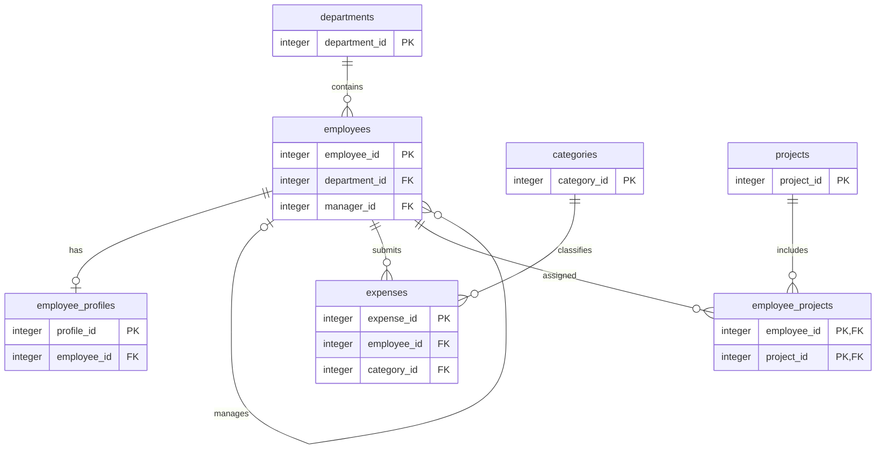

## Q01. Database foundations

    DBMS (Database Management System): Software used to store, retrieve, update, and manage data.

    RDBMS (Relational Database Management System): A type of DBMS that organizes data into related tables consisting of rows and columns.

    PostgreSQL: An open-source relational database management system that supports SQL, constraints, transactions, indexes, and advanced database features.

    SQL (Structured Query Language): A language used to create database objects and retrieve, insert, update, and delete data.

    Database server: The PostgreSQL service that accepts connections and manages databases.

    Database: A collection of related database objects.

    Schema: A namespace inside a database used to organize tables and other objects.

    Table: A structure that stores data in rows and columns.

    Row: One complete record in a table.

    Column: An attribute of a record, such as an employee's name or salary.

### Example scenario:

        Suppose Anu submits a travel expense of ₹1,500. The expense can be stored as a row in the expenses table.

        The database hierarchy for this assignment is:

        PostgreSQL server → org_expenses database → org schema → expenses table → expense row

        A relational table stores structured data with defined columns and constraints. 
        JSON can represent nested or flexible data, but a JSON document does not automatically provide the same relational constraints and relationships as a properly designed database schema.

## Q02. Three schema architecture

    The three-schema architecture separates how users view data from the logical database design and the physical storage of data.

    1. External schema
     The external level describes how a particular user or application sees the data.

    Example: A finance employee sees an expense report containing employee name, department, expense amount, and approval status without needing to see every column in the database.

    2. Conceptual schema
     The conceptual level describes the overall logical structure of the database, including tables, attributes, relationships, and constraints.

    Example: The employees, departments, categories, and expenses tables and their foreign-key relationships form part of the conceptual design.

    3. Internal schema
     The internal level describes how data is physically stored and accessed, including storage pages, indexes, and access methods.

    Example: PostgreSQL may use an index to find expenses for a particular employee efficiently.

### Data independence

    - Logical data independence: The ability to change the logical database structure without requiring unnecessary changes to user views or applications.
        Eg: Adding a new optional column, phone_number, to organization.employees should not require changes to a finance report that does not use that column.

    - Physical data independence: The ability to change physical storage or indexes without changing the logical database design.
        Eg: Creating an index on organization.expenses(employee_id, occurred_on) can improve query performance without changing the table's logical structure or the SQL query's result.

### Three-level diagram

              USERS / APPLICATIONS
                       |
          +-------------------------+
          |     EXTERNAL LEVEL      |
          | Finance report,          |
          | department report, etc.  |
          +-------------------------+
                       |
             External-Conceptual
                   Mapping
                       |
          +-------------------------+
          |    CONCEPTUAL LEVEL     |
          | Complete logical model: |
          | employees, expenses,    |
          | departments, projects   |
          +-------------------------+
                       |
             Conceptual-Internal
                   Mapping
                       |
          +-------------------------+
          |      INTERNAL LEVEL     |
          | Indexes, pages, storage,|
          | access paths             |
          +-------------------------+
                       |
                 PHYSICAL STORAGE

### Examples of each level
External: Data presented to a particular user or application
    Eg: A finance report showing employee names, expense categories, and monthly spending

Conceptual: The overall logical structure and relationships of the database
    Eg: The entity model containing employees, departments, expenses, and projects

Internal: How data is physically organized and accessed
    Eg: A B-tree index on expenses(employee_id, occurred_on)

### Three-schema architecture versus PostgreSQL schema

The three-schema architecture describes levels of abstraction in database design. A PostgreSQL schema is a namespace used to organize objects such as tables, views, functions, and sequences.
    For example, organization.employees means the employees table inside the PostgreSQL schema named organization.

The PostgreSQL namespace named organization is not the same thing as the conceptual level of the three-schema architecture.

Conclusion: External, conceptual, and internal schemas describe database abstraction levels, while a PostgreSQL schema groups database objects under a namespace.

QRequirements and Relationships

## Q03. ER diagram

The following ER diagram represents the seven initial tables in the data contract.
Relationship explanations

A. Departments and employees — one-to-many

    One department can have zero or many employees. Each employee belongs to one department when department_id is mandatory.

    Primary key: departments.department_id
    Foreign key: employees.department_id

B. Employees and employee profiles — one-to-one

    An employee can have zero or one profile, while each profile belongs to exactly one employee.

    Primary key: employee_profiles.profile_id
    Foreign key: employee_profiles.employee_id

    A UNIQUE constraint on employee_profiles.employee_id enforces at most one profile per employee.

    The relationship is optional on the employee side because an employee may not yet have a profile.

C. Employees and managers — self-referencing relationship

    An employee may have zero or one manager, and a manager may supervise multiple employees.

    Primary key: employees.employee_id

    Foreign key: employees.manager_id, referencing employees.employee_id

    A NULL manager ID represents an employee without an assigned manager.

    A row-level CHECK constraint can prevent an employee from managing themselves directly. It does not prevent longer cycles involving multiple employees.

D. Employees and expenses — one-to-many

    One employee may submit many expenses. Each expense belongs to one employee.

    Primary key: expenses.expense_id

    Foreign key: expenses.employee_id

E. Categories and expenses — one-to-many

    One category can classify many expenses. Each expense belongs to one category.

    Primary key: categories.category_id

    Foreign key: expenses.category_id

F. Employees and projects — many-to-many

    An employee may participate in several projects, and a project may contain several employees. The junction table employee_projects implements this relationship.

    employee_projects.employee_id references employees.employee_id.

    employee_projects.project_id references projects.project_id.

    The composite primary key (employee_id, project_id) prevents duplicate assignments for the same employee-project pair.

### Five business rules

Rule 1: Department and employee assignment
- Every employee must belong to exactly one department.
- A department can have zero, one, or many employees.
- Each department name must be unique and cannot be NULL.

Rule 2: Employee manager relationship
- An employee may have no manager or one manager.
- One manager can manage multiple employees.
- manager_id references employees.employee_id, creating a self-referencing relationship.
- An employee cannot be assigned a manager who does not exist.

Rule 3: Employee profile is one-to-one and optional
- An employee may have zero or one profile.
- Each profile belongs to exactly one employee.
- employee_profiles.employee_id is both the primary key and a foreign key, ensuring that an employee cannot have multiple profiles.

Rule 4: Projects and employee assignments
- Each project must belong to exactly one department.
- Employees and projects have a many-to-many relationship.
- The employee_projects junction table implements this relationship using the composite primary key (employee_id, project_id).
- An employee-project pair can appear only once.

Rule 5: Expense validation and auditing
- Every expense must belong to one employee and one category.
- The expense amount must be greater than zero and must not be NULL.
- The expense status must be one of draft, submitted, approved, or rejected, with draft as the default.
- Audit records store historical changes without a foreign key to expenses, so deleting an expense does not automatically delete its audit history.

## Q04 Key Classification

Keys help identify rows uniquely and establish relationships between tables.

1. Key comparison using actual columns

**Superkey**

Any set of columns that uniquely identifies a row

    employees(employee_id, full_name)

**Candidate key**

A minimal set of columns that uniquely identifies a row

    employees.employee_id, assuming it is a primary key

**Primary key**

The candidate key selected as the main identifier

    employees.employee_id

**Alternate key**

A candidate key not selected as the primary key

    employees.employee_code,

**Natural key**

A meaningful identifier from the business domain

    employees.employee_code

**Surrogate key**

An artificially generated identifier without business meaning

    employees.employee_id, if generated as an identity

**Composite key**

A key made up of two or more columns

    employee_projects(employee_id, project_id)

**Foreign key**

A column or set of columns referencing a key in another table

    employee_projects.employee_id references employees.employee_id

2. Employee candidate keys

Under the assumption that the data contract declares employee_id as the primary key and both employee_code and email as individually unique and non-null, the employee candidate keys are:
    employee_id
    employee_code
    email

The primary key is employee_id. The other two are alternate keys.
Candidate keys depend on the declared constraints and business assumptions. If the contract does not guarantee that email is unique and non-null, it cannot automatically be considered a candidate key.

3. Keys in employee_projects

The junction table uses the composite primary key:
    (employee_id, project_id)

Both columns are foreign keys. Together, they uniquely identify an employee's assignment to a project.

For example, the following pairs may exist:
    employee_id     project_id
        1               101
        1               102
        2               101

The same employee can join different projects, and the same project can have different employees. However, the pair (1, 101) must not appear twice.
Neither employee_id nor project_id alone is generally a candidate key for this junction table.

4. Why every superkey is not a candidate key

A superkey uniquely identifies a row, but it may contain unnecessary columns.

Suppose employee_id is unique:
    {employee_id} is a candidate key because it uniquely identifies a row and is minimal.
    {employee_id, full_name} is a superkey because employee_id already uniquely identifies the row.

However, {employee_id, full_name} is not a candidate key because removing full_name still leaves a unique identifier.
Therefore, every candidate key is a superkey, but not every superkey is a candidate key.

## Q05 Attribute Closure

1. Given relation and functional dependencies

Relation:
    R(employee_id, email, department_id, department_name)

Functional dependencies:

    employee_id → email, department_id
    email → employee_id
    department_id → department_name

The closure of an attribute set is the set of all attributes that can be functionally determined by that set.

2. Calculate employee_id+

Start with:
    employee_id+ = {employee_id}

Step 1: Apply employee_id → email, department_id.
    employee_id+ = {employee_id, email, department_id}

Step 2: Apply department_id → department_name.
    employee_id+ = {employee_id, email, department_id, department_name}

No further attributes can be added.

Final closure:
    employee_id+ = {employee_id, email, department_id, department_name}

Since this closure contains every attribute of R, employee_id is a superkey.

3. Calculate email+

Start with:
    email+ = {email}

Step 1: Apply email → employee_id.
    email+ = {email, employee_id}

Step 2: Apply employee_id → email, department_id.
    email+ = {email, employee_id, department_id}

Step 3: Apply department_id → department_name.
    email+ = {email, employee_id, department_id, department_name}

Final closure:
    email+ = {email, employee_id, department_id, department_name}

Since the closure contains every attribute of R, email is a superkey.

4. Calculate department_id+

Start with:
    department_id+ = {department_id}

Step 1: Apply department_id → department_name.
    department_id+ = {department_id, department_name}

No dependency allows us to derive employee_id or email from department_id.

Final closure:
    department_id+ = {department_id, department_name}

Therefore, department_id alone is not a superkey.

5. Find all candidate keys

Attribute set                   Closure contains all attributes            Candidate key

{employee_id}                       Yes                                     Yes

{email}                             Yes                                     Yes

{department_id}                     No                                      No

{employee_id, email}                Yes                                     No; not minimal

{employee_id, department_id}        Yes                                     No; not minimal

The candidate keys are:
    employee_id
    email

### Minimality justification

Both employee_id and email determine every attribute in R individually. Neither is a proper subset of itself, so both are minimal superkeys.
Any larger superkey containing either one is not minimal because it contains an already sufficient candidate key.

Conclusion: The relation has exactly two candidate keys: employee_id and email.

## Q06 Normalization

1. Given relation

ExpenseExport(expense_id, employee_id, employee_name, department_id, department_name, category_id, category_name, amount)

Assume the following functional dependencies:

expense_id → employee_id, employee_name, department_id, department_name, category_id, category_name, amount

employee_id → employee_name, department_id

department_id → department_name

category_id → category_name

The expense ID uniquely identifies each expense record.

2. Problems and anomalies

The original relation repeats employee, department, and category information across expense records.

Update anomaly

If a department name changes, multiple expense rows may need to be updated. If one row is missed, inconsistent department names can appear.

Insertion anomaly

A department or category cannot be recorded independently without inserting an expense row, unless the design allows unrelated or incomplete expense records.

Deletion anomaly

Deleting the last expense associated with an employee or category may unintentionally remove the only stored copy of associated descriptive information.

Normalization reduces these problems by storing each fact in an appropriate relation.

3. First Normal Form (1NF)

A relation is in 1NF when each attribute contains a single atomic value and there are no repeating groups.

Assume each value in the original ExpenseExport relation is atomic and each row represents one expense.

The relation is in 1NF:

ExpenseExport(expense_id, employee_id, employee_name, department_id, department_name, category_id, category_name, amount)

However, atomic values alone do not establish 2NF or 3NF. The functional dependencies must also be considered.

4. Second Normal Form (2NF)

A relation is in 2NF if it is in 1NF and no non-prime attribute depends on only part of a candidate key.

Here, expense_id is a single-attribute candidate key. Therefore, there can be no partial dependency on a proper subset of that key.

Under the stated dependencies, the original relation satisfies 2NF.

However, the relation still contains transitive dependencies:

expense_id → employee_id → employee_name

expense_id → employee_id → department_id → department_name

expense_id → category_id → category_name

These dependencies must be addressed to achieve 3NF.

5. Third Normal Form (3NF)

A relation is in 3NF if, for every nontrivial functional dependency X → A, either X is a superkey or A is a prime attribute.

Decompose the original relation into four relations.

A. Departments

Departments(department_id, department_name)

Functional dependency:

department_id → department_name

Primary key: department_id

B. Employees

Employees(employee_id, employee_name, department_id)

Functional dependency:

employee_id → employee_name, department_id

Primary key: employee_id

Foreign key: department_id references Departments(department_id).

C. Categories

Categories(category_id, category_name)

Functional dependency:

category_id → category_name

Primary key: category_id

D. Expenses

Expenses(expense_id, employee_id, category_id, amount)

Functional dependency:

expense_id → employee_id, category_id, amount

Primary key: expense_id

Foreign keys:

employee_id references Employees(employee_id).

category_id references Categories(category_id).

6. Decomposition diagram

erDiagram
    DEPARTMENTS ||--o{ EMPLOYEES : contains
    EMPLOYEES ||--o{ EXPENSES : submits
    CATEGORIES ||--o{ EXPENSES : classifies

    DEPARTMENTS {
        int department_id PK
        string department_name
    }

    EMPLOYEES {
        int employee_id PK
        string employee_name
        int department_id FK
    }

    CATEGORIES {
        int category_id PK
        string category_name
    }

    EXPENSES {
        int expense_id PK
        int employee_id FK
        int category_id FK
        numeric amount
    }

7. Lossless-join reasoning

The decomposition is lossless under the given functional dependencies.

Departments and Employees share department_id, which is a key of Departments.

Employees and Expenses share employee_id, which is a key of Employees.

Categories and Expenses share category_id, which is a key of Categories.

Each decomposition separates attributes according to their determining keys. Joining the relations using these keys reconstructs the original expense information without introducing spurious combinations, assuming the stated dependencies and referential integrity hold.

8. BCNF check

A relation is in Boyce–Codd Normal Form (BCNF) if, for every nontrivial functional dependency X → Y, X is a superkey.

Under only the given functional dependencies:

Relation

Relevant dependency

Determinant

BCNF?

Departments

department_id → department_name

department_id is a key

Yes

Employees

employee_id → employee_name, department_id

employee_id is a key

Yes

Categories

category_id → category_name

category_id is a key

Yes

Expenses

expense_id → employee_id, category_id, amount

expense_id is a key

Yes

No additional nontrivial dependencies are specified for these decomposed relations. Each determinant in the listed dependencies is a key of its relation.

Therefore, all four relations are in BCNF under the stated dependencies.

Conclusion: Atomicity establishes only the starting requirement for 1NF. It does not prove 3NF. The decomposition removes the transitive dependencies and produces relations that satisfy both 3NF and BCNF under the given assumptions.

## Q07. PostgreSQL Setup

    Installed Postgresql and pgAdmin 4, add the path to environment variables and check the version of psql in command prompt.

        "C:\Program Files\PostgreSQL\18\bin\psql.exe" --version

    After this add the user "-U postgres" and enter the password which is created during the installation of pgAdmin.

        -"C:\Program Files\PostgreSQL\18\bin\psql.exe" -U postgres
          Password for user postgres: 

          psql (18.6)
          WARNING: Console code page (437) differs from Windows code page (1252)
          8-bit characters might not work correctly. See psql reference
          page "Notes for Windows users" for details.
          Type "help" for help.

    Run this SQL query after connecting to PostgreSQL:

    postgres=# SELECT version();
                                    version                                                                                 
    -------------------------------------------------------------------------
    PostgreSQL 18.6 on x86_64-windows, compiled by msvc-19.44.35229, 64-bit
    (1 row)

    postgres=# CREATE DATABASE org_expenses;
    CREATE DATABASE

    postgres=# \connect org_expenses
    You are now connected to database "org_expenses" as user "postgres".

    org_expenses=# CREATE schema org;
    CREATE SCHEMA

    org_expenses=# SELECT schema_name FROM information_schema.schemata WHERE schema_name = 'org';
    schema_name                                                                                                             
    -------------
    org
    (1 row)

    org_expenses=# ALTER SCHEMA org RENAME TO organization;
    ALTER SCHEMA

    org_expenses=# SELECT schema_name FROM information_schema.schemata WHERE schema_name = 'organization';
    schema_name                                                                                                             
    --------------
    organization
    (1 row)

## Q08. Parent Tables and Data Types

### Objective

Create the `departments`, `categories`, and `projects` tables in dependency order, using identity keys, suitable data types, uniqueness constraints, and the required project department foreign key.

### SQL solution

```sql
CREATE TABLE organization.departments (
    department_id INTEGER GENERATED ALWAYS AS IDENTITY PRIMARY KEY,
    name VARCHAR(100) NOT NULL UNIQUE
);

CREATE TABLE organization.categories (
    category_id INTEGER GENERATED ALWAYS AS IDENTITY PRIMARY KEY,
    name VARCHAR(100) NOT NULL UNIQUE
);

CREATE TABLE organization.projects (
    project_id INTEGER GENERATED ALWAYS AS IDENTITY PRIMARY KEY,
    name VARCHAR(150) NOT NULL UNIQUE,
    department_id INTEGER NOT NULL,
    CONSTRAINT fk_projects_department
        FOREIGN KEY (department_id)
        REFERENCES organization.departments(department_id)
        ON DELETE RESTRICT
);

```
### SQL implementation

    The tables organization.departments, organization.categories, and organization.projects were created in dependency order. The department and category tables have identity primary keys and unique, required names. The projects table has an identity primary key, a unique and required name, and a required foreign key referencing organization.departments(department_id).

    The foreign key uses ON DELETE RESTRICT to prevent deleting a department while projects still reference it.

    The runnable DDL is saved in sql/02_parent_tables.sql.

### Explanation of the data types

- `INTEGER`: Stores whole-number identifiers.
- `VARCHAR(100)` and `VARCHAR(150)`: Store names as text with specified maximum lengths.
- `DATE`: Stores a calendar date without a time of day. For example, an expense may have occurred on 2026-10-14.
- `TIMESTAMPTZ`: Stores a timestamp representing an instant in time, with PostgreSQL handling time-zone conversion for display. This is useful when users or systems operate in different time zones.
- `NUMERIC(12,2)`:NUMERIC(12,2) stores exact decimal values with up to 12 total digits, including 2 digits after the decimal point. This is suitable for monetary amounts because it avoids the usual binary floating-point rounding problems.

### Why use identity columns?

`GENERATED ALWAYS AS IDENTITY` lets PostgreSQL generate identifier values automatically. A primary key ensures that each row has a unique, non-null identifier.

### Why use constraints?

- `NOT NULL` requires a value.
- `UNIQUE` prevents duplicate names.
- `PRIMARY KEY` uniquely identifies each row.
- `FOREIGN KEY` ensures a project references an existing department.
- `ON DELETE RESTRICT` prevents deletion of a department while projects still reference it.

Verification queries

```sql
SELECT table_name
FROM information_schema.tables
WHERE table_schema = 'org'
ORDER BY table_name;
    
SELECT * FROM organization.departments;
SELECT * FROM organization.categories;
SELECT * FROM organization.projects;
```

## Q09. Employee relationships

### Implementation

Created `organization.employees` and `organization.employee_profiles`.

- `employee_id` is the primary key of `employees`.
- `employee_code` and `email` are required and unique.
- `department_id` is a required foreign key referencing `organization.departments(department_id)`.
- `manager_id` is an optional self-referencing foreign key referencing `organization.employees(employee_id)`.
- `employee_profiles.employee_id` is both a primary key and a foreign key referencing `employees(employee_id)`. This enforces at most one profile per employee.
- `ON DELETE CASCADE` on the profile foreign key deletes the dependent profile when its employee is deleted.
- The `chk_employee_not_own_manager` CHECK constraint prevents an employee from being their own manager.

### Validation

1. Inserted the test department `test_department` successfully.
2. Attempted to insert an employee with `department_id = 999999`. PostgreSQL rejected it with a foreign-key violation because the department did not exist.
3. Inserted the valid employee `Q9TEST001` and a corresponding employee profile successfully.
4. Attempted to set `manager_id = employee_id`. PostgreSQL rejected the update because of `chk_employee_not_own_manager`.
5. Attempted to insert a second profile for the same employee. PostgreSQL rejected it because `employee_profiles_pkey` was violated.
6. Attempted to insert another employee with the existing code `Q9TEST001`. PostgreSQL rejected it because `employees_employee_code_key` was violated.

### Explanation

The foreign keys maintain referential integrity by ensuring that employees reference existing departments and managers. The profile primary key and foreign key enforce at most one profile per employee. Unique constraints prevent duplicate employee codes and email addresses.

The CHECK constraint prevents direct self-management. However, it does not prevent longer manager cycles, such as employee A managing B while B manages A. Preventing such cycles requires additional logic.

### Source code

org_expenses=# INSERT INTO organization.departments (name) VALUES ('test_department') ON CONFLICT (name) DO NOTHING;

    INSERT 0 1
    org_expenses=# SELECT * FROM organization.departments;
    department_id |      name                                                                                               
    ---------------+-----------------
                1 | test_department
    (1 row)


org_expenses=# INSERT INTO organization.employees (employee_code, email, full_name, department_id, hired_on) VALUES ('Q9BAD001', 'bad001@example.com', 'Invalid Employee', 999999, DATE '2026-10-14');
    ERROR:  insert or update on table "employees" violates foreign key constraint "fk_employees_department"
    DETAIL:  Key (department_id)=(999999) is not present in table "departments".

org_expenses=# INSERT INTO organization.employees     
        (employee_code, email, full_name, department_id, hired_on)
    SELECT
        'Q9TEST001',
        'q9test001@example.com',
        'Test Employee',
        department_id,
        DATE '2026-10-14'
    FROM organization.departments
    WHERE name = 'test_department'
    ON CONFLICT (employee_code) DO NOTHING;
INSERT 0 1

org_expenses=# SELECT * FROM organization.employees;  

 employee_id | employee_code |        email        |   full_name   | department_id | manager_id |  hired_on  | is_active 
-------------+---------------+---------------------+---------------+---------------+------------+------------+-----------
           4 | Q9TEST001     | testemp@example.com | Test Employee |             1 |            | 2026-10-14 | t
(1 row)

org_expenses=# INSERT INTO organization.employee_profiles 
    (employee_id, phone, address) 
    SELECT 
    employee_id, 
    '9876456311',
    'HILL VIEW Address' 
    FROM organization.employees 
    WHERE employee_code = 'Q9TEST001' 
    ON CONFLICT (employee_id)
    DO NOTHING;

INSERT 0 1

org_expenses=# SELECT * FROM organization.employee_profiles;

 employee_id |   phone    |      address                                                                                 
-------------+------------+-------------------
           4 | 9876456311 | HILL VIEW Address
(1 row)

org_expenses=# UPDATE organization.employees SET manager_id = employee_id WHERE employee_code = 'Q9TEST001';

    ERROR:  new row for relation "employees" violates check constraint "chk_employee_not_own_manager"
    DETAIL:  Failing row contains (4, Q9TEST001, testemp@example.com, Test Employee, 1, 4, 2026-10-14, t).

org_expenses=# INSERT INTO organization.employee_profiles (employee_id, phone, address) SELECT employee_id, '8765456546', 'Kochali Appartments' FROM organization.employees WHERE employee_code = 'Q9TEST001';
    
    ERROR:  duplicate key value violates unique constraint "employee_profiles_pkey"
    DETAIL:  Key (employee_id)=(4) already exists.

org_expenses=# INSERT INTO organization.employees
        (employee_code, email, full_name, department_id, hired_on)
    SELECT
        'Q9TEST001',
        'different@example.com',
        'Another Employee',
        department_id,
        DATE '2026-10-14'
    FROM organization.departments
    WHERE name = 'test_department';
    
    ERROR:  duplicate key value violates unique constraint "employees_employee_code_key"
    DETAIL:  Key (employee_code)=(Q9TEST001) already exists.


## Q10. Expenses and the junction table

### Implementation

Created `organization.expenses` and `organization.employee_projects`.

- `expenses` uses an identity primary key, required employee and category foreign keys, a positive required amount, a required occurrence date, a constrained status, and a `TIMESTAMPTZ` update timestamp.
- `employee_projects` uses a composite primary key of `(employee_id, project_id)` to prevent duplicate assignments.
- Both tables have required dates where appropriate.

### Referential actions

- Expenses reference employees and categories with `ON DELETE RESTRICT` to preserve expense history.
- Project assignments reference employees and projects with `ON DELETE CASCADE` because assignments are dependent records.
- The employee foreign key on expenses prevents deletion of an employee who has expense records.

### Validation

Executed `sql/04_expenses_and_projects.sql` and verified that both tables exist in the `organization` schema.

The DDL defines the required constraints and referential actions.

org_expenses=# \i 'sql/02_verify_seed.sql'     
    table_name     | row_count                                                                                           
-------------------+-----------
 categories        |         5
 departments       |         5
 employee_profiles |         7
 employee_projects |        12
 employees         |        13
 expenses          |        40
 projects          |         4
(7 rows) 


### Total expenses from expense table and sum of the expense amount

org_expenses=# SELECT
                    COUNT(*) AS total_expenses,
                    SUM(amount) AS total_expense_amount
                FROM organization.expenses;

 total_expenses | total_expense_amount                                                                                   
----------------+----------------------
             40 |              8047.47
(1 row)

### Each category with the total expense count and total amount

org_expenses=# SELECT
                    c.name AS category_name,
                    COUNT(e.expense_id) AS expense_count,
                    COALESCE(SUM(e.amount), 0) AS total_amount
                FROM organization.categories AS c
                LEFT JOIN organization.expenses AS e
                    ON e.category_id = c.category_id
                GROUP BY c.category_id, c.name
                ORDER BY c.name;

 category_name | expense_count | total_amount                                                                            
---------------+---------------+--------------
 Equipment     |            10 |      3380.00
 Meals         |            10 |       592.00
 Software      |            10 |      1715.47
 Training      |             0 |            0
 Travel        |            10 |      2360.00
(5 rows)


## Question 11: Seed a Useful Dataset

### Objective

The objective is to insert a deterministic sample dataset into the `organization` schema to test table relationships, foreign key constraints, data validation rules, and expense reporting queries.

### Files Submitted

- `sql/02_seed.sql` — inserts the sample departments, categories, projects, employees, employee profiles, project assignments, and expenses.
- `sql/03_baseline_verification.sql` — verifies the initial row counts and expense totals.

### Dataset Requirements

The dataset is designed to satisfy the following requirements:

- At least 4 departments.
- At least 12 employees and 6 employee profiles.
- At least 5 expense categories and 4 projects.
- At least 12 employee-project assignments.
- At least 40 expense records.
- Expense dates spanning July, August, and September 2026.
- Lowercase employee email addresses.
- A department with no employees.
- Employees with no expenses and an employee with no project assignments.
- A manager hierarchy with at least three levels.
- Expenses covering all four statuses: `draft`, `submitted`, `approved`, and `rejected`.
- NULL expense descriptions.
- Categories that satisfy the required submitted/approved expense totals and the specified approved/rejected status conditions.
- Tied employee monthly totals and expense amounts on both sides of the selected amount-band boundaries.

### Implementation Approach

Parent records are inserted before dependent records. Managers are inserted before their reports so that the self-referencing foreign key remains valid.

Natural keys, such as employee codes and category names, are used to identify records instead of assuming fixed identity-generated IDs.

### Baseline Verification

The baseline verification query records the row counts for each table, the total number and amount of expenses, and the expense totals by category.

The baseline must be recorded before running temporary experiments so that later changes can be compared with the original dataset.

### Conclusion

The seed dataset and verification queries provide a repeatable way to test the database structure, relationships, business rules, and reporting queries.

Before execution, verify that the seed script matches the existing database data. Do not run a newly generated seed script against an already populated database without checking for duplicate or unintended records.

### Departments without employees

org_expenses=# SELECT d.department_id, d.name
                 FROM organization.departments AS d
                 LEFT JOIN organization.employees AS e
                     ON e.department_id = d.department_id
                 WHERE e.employee_id IS NULL;

 department_id |    name                                                                                                 
---------------+------------
             5 | Operations

### Employees who have no expenses

org_expenses=# SELECT e.employee_code, e.full_name
                    FROM organization.employees AS e
                    WHERE NOT EXISTS (
                    SELECT 1
                    FROM organization.expenses AS x
                    WHERE x.employee_id = e.employee_id
                )
                ORDER BY e.employee_code;
                
employee_code |   full_name                                                                                             
---------------+---------------
 E11           | Kiran Joseph
 E12           | Leena Paul
 Q9TEST001     | Test Employee
(3 rows)

### Categories without expenses

org_expenses=# SELECT c.category_id, c.name
                FROM organization.categories AS c
                LEFT JOIN organization.expenses AS e
                    ON e.category_id = c.category_id
                WHERE e.expense_id IS NULL;

 category_id |   name                                                                                                    
-------------+----------
           5 | Training
(1 row)

### Employees who are not assigned to any project

org_expenses=# SELECT e.employee_code, e.full_name
                FROM organization.employees AS e
                WHERE NOT EXISTS (
                    SELECT 1
                    FROM organization.employee_projects AS ep
                    WHERE ep.employee_id = e.employee_id
                )
                ORDER BY e.employee_code;

 employee_code |   full_name                                                                                             
---------------+---------------
 E12           | Leena Paul
 Q9TEST001     | Test Employee
(2 rows)

### Employees assigned to two or more projects

org_expenses=# SELECT
                    e.employee_code,
                    e.full_name,
                    COUNT(*) AS project_count
                FROM organization.employee_projects AS ep
                JOIN organization.employees AS e
                    ON e.employee_id = ep.employee_id
                GROUP BY e.employee_id, e.employee_code, e.full_name
                HAVING COUNT(*) >= 2;

 employee_code |  full_name   | project_count                                                                            
---------------+--------------+---------------
 E01           | Alice Morgan |             2    

### Count expenses by status

org_expenses=# SELECT status, COUNT(*) AS expense_count
                FROM organization.expenses
                GROUP BY status
                ORDER BY status;

  status   | expense_count                                                                                               
-----------+---------------
 approved  |            13
 draft     |             2
 rejected  |            12
 submitted |            13
(4 rows)

### Checking which months contain expenses

org_expenses=#  SELECT
                     date_trunc('month', occurred_on)::date AS month,
                     COUNT(*) AS expense_count
                 FROM organization.expenses
                 GROUP BY 1
                 ORDER BY 1;

   month    | expense_count                                                                                              
------------+---------------
 2026-07-01 |            12
 2026-08-01 |            12
 2026-09-01 |            16
(3 rows)

org_expenses=# SELECT COUNT(*) AS expense_without_description
                FROM organization.expenses WHERE description IS NULL;

 expense_without_description                                                                                             
-----------------------------
                           2
(1 row)


org_expenses=# SELECT
                    date_trunc('month', occurred_on)::date AS month,
                    COUNT(*) AS expense_count
                FROM organization.expenses
                GROUP BY 1
                ORDER BY 1;

   month    | expense_count                                                                                              
------------+---------------
 2026-07-01 |            12
 2026-08-01 |            12
 2026-09-01 |            16
(3 rows)


org_expenses=# SELECT COUNT(*) AS expense_without_description
                 FROM organization.expenses WHERE description IS NULL;
 expense_without_description                                                                                             
-----------------------------
                           2
(1 row)


org_expenses=# SELECT
                c.name AS category_name,
                COUNT(e.expense_id) FILTER (
                    WHERE e.status IN ('submitted', 'approved')
                ) AS submitted_approved_count,
                COALESCE(
                    SUM(e.amount) FILTER (
                        WHERE e.status IN ('submitted', 'approved')
                    ), 0
                ) AS submitted_approved_total,
                COUNT(e.expense_id) FILTER (
                    WHERE e.status = 'approved'
                ) AS approved_count,
                COUNT(e.expense_id) FILTER (
                    WHERE e.status = 'rejected'
                ) AS rejected_count
            FROM organization.categories AS c
            LEFT JOIN organization.expenses AS e
                ON e.category_id = c.category_id
            GROUP BY c.category_id, c.name
            ORDER BY c.name;

 category_name | submitted_approved_count | submitted_approved_total | approved_count | rejected_count                   
---------------+--------------------------+--------------------------+----------------+----------------
 Equipment     |                       10 |                  3380.00 |              5 |              0
 Meals         |                        0 |                        0 |              0 |             10
 Software      |                        6 |                   975.48 |              3 |              2
 Training      |                        0 |                        0 |              0 |              0
 Travel        |                       10 |                  2360.00 |              5 |              0
(5 rows)

### Verification of the three-level manager hierarchy

org_expenses=# SELECT
                    e.employee_code,
                    e.full_name AS employee_name,
                    m.full_name AS manager_name,
                    gm.full_name AS grand_manager_name
                FROM organization.employees AS e
                LEFT JOIN organization.employees AS m
                    ON e.manager_id = m.employee_id
                LEFT JOIN organization.employees AS gm
                    ON m.manager_id = gm.employee_id
                ORDER BY e.employee_code;

 employee_code | employee_name | manager_name | grand_manager_name                                                       
---------------+---------------+--------------+--------------------
 E01           | Alice Morgan  |              | 
 E02           | Ben Carter    | Alice Morgan | 
 E03           | Cara Wilson   | Ben Carter   | Alice Morgan
 E04           | Dev Kumar     | Ben Carter   | Alice Morgan
 E05           | Emma Davis    |              | 
 E06           | Farah Khan    | Emma Davis   | 
 E07           | Gopal Rao     | Farah Khan   | Emma Davis
 E08           | Hari Nair     | Farah Khan   | Emma Davis
 E09           | Isha Patel    |              | 
 E10           | Jay Thomas    | Isha Patel   |                                                                          
 E11           | Kiran Joseph  | Jay Thomas   | Isha Patel
 E12           | Leena Paul    | Jay Thomas   | Isha Patel
 Q9TEST001     | Test Employee |              | 
(13 rows)

### Verify category totals

org_expenses=# SELECT
                    c.name AS category_name,
                    COUNT(*) AS expense_count,
                    SUM(e.amount) AS total_amount
                FROM organization.expenses AS e
                JOIN organization.categories AS c
                    ON e.category_id = c.category_id
                WHERE e.status IN ('submitted', 'approved')
                GROUP BY c.name
                HAVING COUNT(*) >= 3
                    AND SUM(e.amount) > 1000
                ORDER BY c.name;

 category_name | expense_count | total_amount                                                                            
---------------+---------------+--------------
 Equipment     |            10 |      3380.00
 Travel        |            10 |      2360.00
(2 rows)

### Verify category status conditions

org_expenses=# SELECT
                    c.name AS category_name,
                    COUNT(*) FILTER (
                        WHERE e.status = 'approved'
                    ) AS approved_count,
                    COUNT(*) FILTER (
                        WHERE e.status = 'rejected'
                    ) AS rejected_count
                FROM organization.categories AS c
                LEFT JOIN organization.expenses AS e
                    ON c.category_id = e.category_id
                GROUP BY c.category_id, c.name
                ORDER BY c.name;

 category_name | approved_count | rejected_count                                                                         
---------------+----------------+----------------
 Equipment     |              5 |              0
 Meals         |              0 |             10
 Software      |              3 |              2
 Training      |              0 |              0
 Travel        |              5 |              0
(5 rows)

### Verify tied employee monthly totals

org_expenses=# WITH monthly_totals AS (
                    SELECT
                        e.employee_code,
                        DATE_TRUNC('month', x.occurred_on)::date AS expense_month,
                        SUM(x.amount) AS monthly_total
                    FROM organization.expenses AS x
                    JOIN organization.employees AS e
                        ON x.employee_id = e.employee_id
                    GROUP BY
                        e.employee_code,
                        DATE_TRUNC('month', x.occurred_on)::date
                )
                 SELECT
                     expense_month,
                     monthly_total,
                     COUNT(*) AS employee_count
                 FROM monthly_totals
                 GROUP BY expense_month, monthly_total
                 HAVING COUNT(*) >= 2
                 ORDER BY expense_month, monthly_total;

 expense_month | monthly_total | employee_count                                                                          
---------------+---------------+----------------
 2026-07-01    |        849.99 |              2
(1 row)

### Verify expense amounts around the band boundaries

org_expenses=# SELECT
                     COUNT(*) FILTER (WHERE amount < 100) AS below_100,
                     COUNT(*) FILTER (WHERE amount > 100 AND amount < 500) AS between_100_and_500,
                     COUNT(*) FILTER (WHERE amount > 500) AS above_500
                 FROM organization.expenses;

 below_100 | between_100_and_500 | above_500                                                                             
-----------+---------------------+-----------
        16 |                  18 |         3
(1 row)

### Verify all employee emails are lowercase

org_expenses=# SELECT employee_code, email
                 FROM organization.employees
                 WHERE email <> LOWER(email);
 employee_code | email                                                                                                   
---------------+-------
(0 rows)

## Q12: Constraint failures

### Objective
Demonstrate one valid control case and six rejected cases using PostgreSQL constraints. Each test was isolated in a transaction, with `ROLLBACK` used for recovery.

### 1. Valid control case — Accepted
A valid employee record was inserted using an existing department and valid values. PostgreSQL accepted the insert and returned the generated `employee_id`.

Recovery: `ROLLBACK` was executed to remove the test record and restore the database to its previous state.

### 2. Rejected case — Duplicate email
An employee insert was attempted using an email address that already existed.

Expected result: Rejected by the `UNIQUE` constraint on `email`.

Recovery: `ROLLBACK` ended the failed transaction.

### 3. Rejected case — Missing employee name
An employee insert was attempted with `full_name = NULL`.

Expected result: Rejected by the `NOT NULL` constraint on `full_name`.

Recovery: `ROLLBACK` ended the failed transaction.

### 4. Rejected case — Nonpositive expense amount
An expense insert was attempted with `amount = 0`.

Expected result: Rejected by the `CHECK (amount > 0)` constraint.

Recovery: `ROLLBACK` ended the failed transaction.

### 5. Rejected case — Invalid expense status
An expense insert was attempted with the status `pending_review`.

Expected result: Rejected because the status did not match the allowed values: `draft`, `submitted`, `approved`, or `rejected`.

Recovery: `ROLLBACK` ended the failed transaction.

### 6. Rejected case — Missing parent record
An expense insert was attempted using a nonexistent `employee_id`.

Expected result: Rejected by the employee foreign key constraint.

Recovery: `ROLLBACK` ended the failed transaction.

### 7. Rejected case — Duplicate project assignment
An existing employee–project pair was inserted again into `organization.employee_projects`.

Expected result: Rejected by the composite primary key on `(employee_id, project_id)`.

Recovery: `ROLLBACK` ended the failed transaction.

### Why does `CHECK (amount > 0)` alone allow NULL?

A `CHECK` constraint rejects a row when its condition evaluates to `FALSE`. If `amount` is `NULL`, the comparison `amount > 0` evaluates to `UNKNOWN`, not `FALSE`, so the `CHECK` constraint alone allows it.

To require a positive, non-null amount, define both constraints:

```sql
amount NUMERIC(12,2) NOT NULL CHECK (amount > 0)
```

### Conclusion
The tests demonstrate how `UNIQUE`, `NOT NULL`, `CHECK`, foreign key, and composite primary key constraints protect data integrity. Failed test transactions were rolled back to allow the next test to run safely.

## Q13 — Read and Filter

### Objective
Retrieve the first five active employees hired before `2026-07-01`, displaying their employee code, full name, and email. Sort the results by name and then employee ID.

### SQL Query

```sql
SELECT employee_code, full_name, email
FROM organization.employees
WHERE is_active = TRUE
  AND hired_on < DATE '2026-07-01'
ORDER BY full_name, employee_id
LIMIT 5;
```

### Explanation

- Projection (`SELECT`): Displays only `employee_code`, `full_name`, and `email`.
- Filtering (`WHERE`): Selects active employees hired before July 1, 2026.
- Sorting (`ORDER BY`): Sorts by `full_name`, then `employee_id` to make the ordering deterministic when names are equal.
- Limiting (`LIMIT`): Returns at most five rows.

### Result
The query executed successfully. Attach or paste the actual `psql` output below to provide evidence of the returned rows.

### Conclusion
The query demonstrates how `SELECT`, `WHERE`, `ORDER BY`, and `LIMIT` work together to retrieve and present a filtered set of employee records.

## Q14 — NULL and Search Conditions

### 1. Find employees without managers

Query:
```sql
SELECT employee_id, employee_code, full_name, manager_id
FROM organization.employees
WHERE manager_id IS NULL
ORDER BY employee_id;
```

Explanation:

- `IS NULL` identifies employees whose `manager_id` has no value.
- `ORDER BY employee_id` sorts the results by employee ID.

### 2. Find expense descriptions containing "taxi" regardless of case

Query:
```sql
SELECT expense_id, description, amount, occurred_on
FROM organization.expenses
WHERE description ILIKE '%taxi%'
ORDER BY expense_id;
```

Explanation:

- `ILIKE` performs case-insensitive pattern matching in PostgreSQL.
- `%taxi%` finds descriptions containing `taxi` anywhere in the text, regardless of letter case.
- `ORDER BY expense_id` sorts the results by expense ID.

### 3. Find expenses by date range and amount

Query:
```sql
SELECT expense_id, occurred_on, amount, description
FROM organization.expenses
WHERE occurred_on >= DATE '2026-07-01'
  AND occurred_on < DATE '2026-10-01'
  AND amount BETWEEN 100 AND 1000
ORDER BY occurred_on, expense_id;
```

Explanation:

- The date conditions include July 1, 2026, but exclude October 1, 2026. This is a half-open date interval covering July, August, and September.
- `BETWEEN 100 AND 1000` includes both 100 and 1,000.
- `ORDER BY occurred_on, expense_id` sorts by date and then by expense ID.

### Why does `= NULL` fail?

SQL uses three-valued logic: `TRUE`, `FALSE`, and `UNKNOWN`. Comparing a value with `NULL` using `= NULL` produces `UNKNOWN`, not `TRUE`. Therefore, `WHERE manager_id = NULL` does not find rows with missing managers.

The correct condition is:

```sql
WHERE manager_id IS NULL;
```

Use `IS NOT NULL` to find rows where a value exists.

### Conclusion

These queries demonstrate how to filter rows using `NULL` conditions, case-insensitive text searches, date intervals, and inclusive numeric ranges in PostgreSQL.

## Q15 — Insert an Expense Using RETURNING

### 1. Insert a new expense

Query:
```sql
    INSERT INTO organization.expenses
         (employee_id, category_id, amount, occurred_on, description, status)
     SELECT
         e.employee_id,
         c.category_id,
         450.00,
         DATE '2026-10-15',
         'Q15 test expense',
         'submitted'
     FROM organization.employees AS e
     CROSS JOIN organization.categories AS c
     WHERE e.employee_code = 'Q9TEST001'
       AND c.name = 'Travel'
     RETURNING expense_id, amount, status;

```
 expense_id | amount |  status                                                                                           
------------+--------+-----------
         44 | 450.00 | submitted
(1 row)

Explanation:

- `INSERT INTO` creates a new expense record.
- `VALUES` specifies the employee, category, amount, date, description, and status.
- `CROSS JOIN` — creates combinations of employee and category rows.
- `RETURNING` immediately displays selected values from the inserted row, including its database-generated `expense_id`.

### 2. Read the inserted expense

Use the actual `expense_id` returned by the insert query.

```sql
SELECT expense_id, employee_id, category_id,
       amount, occurred_on, description, status
FROM organization.expenses
WHERE expense_id = 44;
```
 expense_id | employee_id | category_id | amount | occurred_on |   description    |  status                              
------------+-------------+-------------+--------+-------------+------------------+-----------
         44 |           4 |           1 | 450.00 | 2026-10-15  | Q15 test expense | submitted
(1 row)

### CRUD explanation

- Create: The `INSERT` statement adds a new expense.
- Read: The `SELECT` statement retrieves that expense using its generated ID.
- `RETURNING` helps obtain the generated ID immediately without a separate query to discover it.

### Conclusion

This task demonstrates the Create and Read operations of CRUD in PostgreSQL. It also shows how `RETURNING` retrieves values from rows affected by an SQL statement.

## Q16 — Update Safely

### Query

```sql
UPDATE organization.expenses
SET amount = 550.00,
    description = 'Q16 updated test expense'
WHERE expense_id = 44
RETURNING expense_id, amount, description, status;
```

 expense_id | amount |       description        |  status                                                                
------------+--------+--------------------------+-----------
         44 | 550.00 | Q16 updated test expense | submitted
(1 row)

### Explanation

- `UPDATE` modifies existing records in a table.
- `SET` specifies the columns and their new values.
- `WHERE expense_id = 44` restricts the update to the intended expense.
- `RETURNING` displays the updated values immediately.

### Verification

The returned row showed expense ID `44`, amount `550.00`, description `Q16 updated test expense`, and status `submitted`.

The command reported one updated row (`UPDATE 1`).

    SELECT expense_id, amount, description, status
    FROM organization.expenses
    WHERE expense_id = 44;

 expense_id | amount |       description        |  status                                                                
------------+--------+--------------------------+-----------
         44 | 550.00 | Q16 updated test expense | submitted
(1 row)

### Risk of UPDATE without WHERE

Without a `WHERE` condition, PostgreSQL updates every row in the table. This could unintentionally modify all expense records. A restrictive condition using the primary key helps target the intended record.

### Conclusion

This task demonstrates the safe use of `UPDATE`, `WHERE`, and `RETURNING` in PostgreSQL.

<!-- ## Q17 — Delete Safely

### Query

```sql
DELETE FROM organization.expenses
WHERE expense_id = 44
RETURNING expense_id, amount, description, status;
```

### Evidence

The `DELETE ... RETURNING` statement returned the deleted row:
 expense_id | amount |       description        |  status                                                                
------------+--------+--------------------------+-----------
         44 | 550.00 | Q16 updated test expense | submitted
(1 row)

The terminal confirmed that one row was deleted.

### Explanation

- `DELETE` removes selected rows from a table.
- `WHERE expense_id = 44` restricts the deletion to the intended expense.
- `RETURNING` displays the deleted row's values.

### Verification

The follow-up `SELECT` query checks whether expense ID `44` remains in the table. The expected result is zero rows. -->

## Q17 — Delete, TRUNCATE, and DROP

### 1. DELETE

```sql
DELETE FROM organization.expenses
WHERE expense_id = 44
RETURNING expense_id, amount, description, status;
```
 expense_id | amount | description | status                                                                              
------------+--------+-------------+--------
(0 rows)

The statement deleted only expense ID `44`. The returned row showed amount `550.00`, description `Q16 updated test expense`, and status `submitted`.

A follow-up `SELECT` returned zero rows, confirming that the expense was absent.

### 2. TRUNCATE Experiment

A scratch table named `organization.q17_scratch` was created with two test rows.

```sql
org_expenses=# CREATE TABLE organization.q17_scratch (
                     id INTEGER PRIMARY KEY,
                     note VARCHAR(100) NOT NULL
                 );

             INSERT INTO organization.q17_scratch (id, note)
                VALUES
                    (1, 'First test row'),
                    (2, 'Second test row');
            
             SELECT * FROM organization.q17_scratch ORDER BY id;
```

 id |      note                                                                                                          
----+-----------------
  1 | First test row
  2 | Second test row
(2 rows)

```sql
BEGIN;

TRUNCATE TABLE organization.q17_scratch;

SELECT * FROM organization.q17_scratch;
```
 id | note                                                                                                               
----+------
(0 rows)

```sql
ROLLBACK;

SELECT * FROM organization.q17_scratch
ORDER BY id;
```

 id |      note                                                                                                          
----+-----------------
  1 | First test row
  2 | Second test row
(2 rows)

The table was empty after `TRUNCATE` within the transaction. After `ROLLBACK`, both original rows were present again.

### 3. DROP Experiment

The scratch table was dropped inside a transaction and the transaction was rolled back.

```sql
BEGIN;

DROP TABLE organization.q17_scratch;
```
 to_regclass                                                                                                             
-------------
 
```sql
SELECT to_regclass('organization.q17_scratch');

ROLLBACK;

SELECT to_regclass('organization.q17_scratch');
```
       to_regclass                                                                                                       
--------------------------
 organization.q17_scratch
(1 row)

```sql
SELECT *
FROM organization.q17_scratch
ORDER BY id;
```

 id |      note                                                                                                          
----+-----------------
  1 | First test row
  2 | Second test row
(2 rows)

The rollback restored the table and its data. PostgreSQL supports rolling back `DROP TABLE` when it is executed inside a transaction.

### 4. Comparison

| Command | Purpose | Effect |
|---|---|---|
| `DELETE` | Remove selected rows | Removes rows matching `WHERE`; without `WHERE`, removes all rows |
| `TRUNCATE` | Empty a table efficiently | Removes all rows but keeps the table structure |
| `DROP` | Remove a table | Removes the table structure and its data |

### 5. PostgreSQL Transaction Behavior

PostgreSQL supports transactional `DELETE`, `TRUNCATE`, and `DROP TABLE`. When these operations are executed inside a transaction, `ROLLBACK` can undo them before the transaction is committed.

### Conclusion

This task demonstrates targeted deletion, the difference between removing rows and removing a table, and PostgreSQL's transactional rollback behavior. All destructive experiments were performed on a separate scratch table.

## Q18 — Alter the Schema

### 1. Add the optional column

```sql
ALTER TABLE organization.expenses
ADD COLUMN receipt_reference TEXT;
```

SELECT expense_id, amount, description, receipt_reference
 FROM organization.expenses
 ORDER BY expense_id
 LIMIT 5;

 expense_id | amount |    description     | receipt_reference                                                            
------------+--------+--------------------+-------------------
          1 | 125.00 | Keyboard and mouse | 
          2 |  60.00 | Team dinner        | 
          3 | 180.00 | Team meeting       | 
          4 |  49.99 |                    | 
          5 |  72.00 | Project meal       | 
(5 rows)

Explanation: `ALTER TABLE` modifies an existing table. The new `receipt_reference` column uses the `TEXT` data type and is nullable because `NOT NULL` was not specified. Existing records can therefore have a `NULL` receipt reference.

### 2. Insert a sample reference

```sql
UPDATE organization.expenses
SET receipt_reference = 'RECEIPT-2026-001'
WHERE expense_id = 1
RETURNING expense_id, amount, description, receipt_reference;
```
 expense_id | amount |    description     | receipt_reference                                                            
------------+--------+--------------------+-------------------
          1 | 125.00 | Keyboard and mouse | RECEIPT-2026-001
(1 row)

Result: The statement updated one row and returned the reference `RECEIPT-2026-001`.

### 3. Retrieve and validate the reference

```sql
SELECT expense_id, receipt_reference
FROM organization.expenses
WHERE expense_id = 1;
```

 expense_id | receipt_reference                                                                                          
------------+-------------------
          1 | RECEIPT-2026-001
(1 row)

### 4. Data migration before adding NOT NULL

Before changing an existing nullable column to `NOT NULL`, check for rows containing `NULL`:

```sql
SELECT COUNT(*) AS missing_references
FROM organization.expenses
WHERE receipt_reference IS NULL;
```

If the count is greater than zero, decide how to handle those rows. Depending on the business requirements, might backfill valid references from source records or obtain the missing information. Not invent receipt references merely to satisfy the constraint.
Populate all existing NULL values with a valid, non-null default or placeholder value.

After resolving all missing values, verify that no `NULL` values remain, then apply:

```sql
ALTER TABLE organization.expenses
ALTER COLUMN receipt_reference SET NOT NULL;
```

This final change is an example only; the assignment requires the column to remain optional, so do not run it now.

### Conclusion

The `receipt_reference` column was added successfully, and a sample value was stored and retrieved. The column remains nullable for later exercises.

## Q19 — String Scalar Functions

### Query 1: Employee Directory

```sql
SELECT
    employee_id,
    UPPER(full_name) AS employee_name,
    LOWER(email) AS email,
    LENGTH(full_name) AS name_length
FROM organization.employees
ORDER BY employee_id
LIMIT 10;
```

Representative output:

 employee_id | employee_name |          email           | name_length                                                    
-------------+---------------+--------------------------+-------------
           4 | TEST EMPLOYEE | testemp@example.com      |          13
           7 | ALICE MORGAN  | alice.morgan@example.com |          12
           8 | EMMA DAVIS    | emma.davis@example.com   |          10
           9 | ISHA PATEL    | isha.patel@example.com   |          10
          10 | BEN CARTER    | ben.carter@example.com   |          10
          11 | FARAH KHAN    | farah.khan@example.com   |          10
          12 | JAY THOMAS    | jay.thomas@example.com   |          10
          13 | CARA WILSON   | cara.wilson@example.com  |          11
          14 | DEV KUMAR     | dev.kumar@example.com    |           9
          15 | GOPAL RAO     | gopal.rao@example.com    |           9
(10 rows)

Explanation:

- `UPPER(full_name)` converts employee names to uppercase.
- `LOWER(email)` converts email addresses to lowercase.
- `LENGTH(full_name)` returns the number of characters in each employee's name, including spaces.
- `ORDER BY` sorts the results by employee ID.
- `LIMIT 10` returns at most ten rows.

### Query 2: Expense Listing with NULL Handling

```sql
SELECT
    expense_id,
    amount,
    COALESCE(description, 'No description provided') AS expense_description,
    receipt_reference
FROM organization.expenses
ORDER BY expense_id
LIMIT 10;
```

Representative output:

 expense_id | amount |   expense_description   | receipt_reference                                                       
------------+--------+-------------------------+-------------------
          1 | 125.00 | Keyboard and mouse      | RECEIPT-2026-001
          2 |  60.00 | Team dinner             | 
          3 | 180.00 | Team meeting            | 
          4 |  49.99 | No description provided | 
          5 |  72.00 | Project meal            | 
          6 |  55.00 | Meeting meal            | 
          7 | 410.00 | Conference travel       | 
          8 | 275.00 | Training travel         | 
          9 |  50.00 | Team lunch              | 
         10 | 145.00 | Adapter purchase        | 
(10 rows)

Explanation:

- `COALESCE(description, 'No description provided')` returns the original description when it is not `NULL`; otherwise, it returns the chosen placeholder.
- The query changes only the displayed result, not the stored description.
- The `receipt_reference` column remains optional and can contain `NULL`.

### Scalar Expressions

Scalar expressions produce one value for each input row. For example, `UPPER(full_name)` produces an uppercase name for each employee row, and `LENGTH(full_name)` produces a character count for each employee row.

### Conclusion

The queries demonstrate string formatting, character counting, and NULL handling using PostgreSQL scalar functions.

## Q20. Numeric and Date Scalar Functions

### Objective
Use numeric and date scalar functions in PostgreSQL to calculate rounded values, extract date components, group expenses by month, and classify expenses into size bands.

### 1. ROUND() — Numeric Calculation

```sql
SELECT
    expense_id,
    amount,
    ROUND(amount / 3, 2) AS share_per_person
FROM organization.expenses
ORDER BY expense_id
LIMIT 10;
```

Explanation: `ROUND(amount / 3, 2)` divides each expense amount by three and rounds the result to two decimal places. This is useful for financial calculations that require a fixed number of decimal places.

Representative output:

 expense_id | amount | share_per_person                                                                                  
------------+--------+------------------
          1 | 125.00 |            41.67
          2 |  60.00 |            20.00
          3 | 180.00 |            60.00
          4 |  49.99 |            16.66
          5 |  72.00 |            24.00
          6 |  55.00 |            18.33
          7 | 410.00 |           136.67
          8 | 275.00 |            91.67
          9 |  50.00 |            16.67
         10 | 145.00 |            48.33
(10 rows)

### 2. EXTRACT() — Year and Month

```sql
SELECT
    expense_id,
    occurred_on,
    EXTRACT(YEAR FROM occurred_on) AS expense_year,
    EXTRACT(MONTH FROM occurred_on) AS expense_month
FROM organization.expenses
ORDER BY expense_id
LIMIT 10;
```

 expense_id | occurred_on | expense_year | expense_month                                                                 
------------+-------------+--------------+---------------
          1 | 2026-07-21  |         2026 |             7
          2 | 2026-09-25  |         2026 |             9
          3 | 2026-07-18  |         2026 |             7
          4 | 2026-08-24  |         2026 |             8
          5 | 2026-09-12  |         2026 |             9
          6 | 2026-09-05  |         2026 |             9
          7 | 2026-09-02  |         2026 |             9
          8 | 2026-09-15  |         2026 |             9
          9 | 2026-07-12  |         2026 |             7
         10 | 2026-09-23  |         2026 |             9
(10 rows)

Explanation: `EXTRACT()` retrieves a specific component from a date. Here, it extracts the year and month from `occurred_on`. This is useful for date-based filtering, reporting, and analysis.

### 3. date_trunc() — Monthly Expense Summary

```sql
SELECT
    date_trunc('month', occurred_on::timestamp) AS expense_month,
    COUNT(*) AS expense_count,
    SUM(amount) AS total_amount
FROM organization.expenses
GROUP BY date_trunc('month', occurred_on::timestamp)
ORDER BY expense_month;
```

Representative output:

    expense_month    | expense_count | total_amount                                                                      
---------------------+---------------+--------------
 2026-07-01 00:00:00 |            12 |      2064.98
 2026-08-01 00:00:00 |            12 |      2621.99
 2026-09-01 00:00:00 |            16 |      3360.50
(3 rows)


Explanation: `date_trunc('month', ...)` truncates each date to the beginning of its month. `GROUP BY` groups expenses by month, `COUNT(*)` counts the records, and `SUM(amount)` calculates the total expenses for each month.

### 4. CASE — Expense Classification

```sql
SELECT
    expense_id,
    amount,
    CASE
        WHEN amount > 0 AND amount <= 100 THEN 'Small'
        WHEN amount > 100 AND amount <= 500 THEN 'Medium'
        WHEN amount > 500 THEN 'Large'
        ELSE 'Invalid amount'
    END AS expense_band
FROM organization.expenses
ORDER BY amount, expense_id
LIMIT 15;
```

 expense_id | amount | expense_band
------------+--------+--------------
         33 |  15.00 | Small
         26 |  25.00 | Small
         17 |  35.00 | Small
         27 |  38.00 | Small
         14 |  42.00 | Small
          4 |  49.99 | Small
          9 |  50.00 | Small
          6 |  55.00 | Small
          2 |  60.00 | Small
         19 |  65.00 | Small
         22 |  69.99 | Small
          5 |  72.00 | Small                                                                                             
         29 |  80.00 | Small
         31 |  85.50 | Small
         15 |  95.00 | Small
(15 rows)

For dispaying the last 15 rows:

```sql
    SELECT
        expense_id,
        amount,
        CASE
            WHEN amount > 0 AND amount <= 100 THEN 'Small'
            WHEN amount > 100 AND amount <= 500 THEN 'Medium'
            WHEN amount > 500 THEN 'Large'
            ELSE 'Invalid amount'
        END AS expense_band
    FROM organization.expenses
    ORDER BY amount DESC, expense_id DESC
    LIMIT 15;
```

 expense_id | amount | expense_band                                                                                      
------------+--------+--------------
         35 | 650.00 | Large
         12 | 620.00 | Large
         36 | 540.00 | Large
         40 | 500.00 | Medium
         37 | 500.00 | Medium
         32 | 450.00 | Medium
          7 | 410.00 | Medium
         21 | 350.00 | Medium
         34 | 330.00 | Medium
         11 | 275.00 | Medium
          8 | 275.00 | Medium
         39 | 250.00 | Medium                                                                                            
         20 | 220.00 | Medium
         23 | 215.00 | Medium
         25 | 200.00 | Medium
(15 rows)

Explanation: `CASE` evaluates conditions in order and returns a label for each expense. The conditions define three non-overlapping bands that cover every positive amount:

- Small: greater than 0 and less than or equal to 100.
- Medium: greater than 100 and less than or equal to 500.
- Large: greater than 500.

The `ELSE` branch handles values that do not satisfy any of the positive-amount conditions.

### 5. Boundary-Value Validation

```sql
SELECT
    amount,
    CASE
        WHEN amount > 0 AND amount <= 100 THEN 'Small'
        WHEN amount > 100 AND amount <= 500 THEN 'Medium'
        WHEN amount > 500 THEN 'Large'
        ELSE 'Invalid amount'
    END AS expense_band
FROM (
    VALUES
        (100.00::numeric),
        (100.01::numeric),
        (500.00::numeric),
        (500.01::numeric)
) AS boundary_examples(amount)
ORDER BY amount;
```

Actual output:

 amount | expense_band                                                                                                   
--------+--------------
 100.00 | Small
 100.01 | Medium
 500.00 | Medium
 500.01 | Large
(4 rows)

Validation result: All four boundary values were classified correctly. The test used temporary values in a query and did not modify the actual expense records.

### Conclusion

PostgreSQL numeric and date scalar functions support financial calculations and date-based reporting. `ROUND()` handles decimal precision, `EXTRACT()` retrieves date components, `date_trunc()` supports monthly aggregation, and `CASE` classifies values according to defined conditions. Boundary testing confirms that every positive amount belongs to exactly one expense band.

## Q21. INNER JOIN and LEFT JOIN

### Objective
Retrieve expense details with employee, department, and category names using `INNER JOIN`.
Use `LEFT JOIN` to list all employees, including those who have no expenses.

### 1. INNER JOIN

```sql
SELECT
    ex.expense_id,
    ex.amount,
    ex.occurred_on,
    emp.full_name AS employee_name,
    dep.name AS department_name,
    cat.name AS category_name
FROM organization.expenses AS ex
INNER JOIN organization.employees AS emp
    ON ex.employee_id = emp.employee_id
INNER JOIN organization.departments AS dep
    ON emp.department_id = dep.department_id
INNER JOIN organization.categories AS cat
    ON ex.category_id = cat.category_id
ORDER BY ex.expense_id
LIMIT 10;
```

 expense_id | amount | occurred_on | employee_name | department_name | category_name                                     
------------+--------+-------------+---------------+-----------------+---------------
          1 | 125.00 | 2026-07-21  | Cara Wilson   | IT              | Equipment
          2 |  60.00 | 2026-09-25  | Jay Thomas    | HR              | Meals
          3 | 180.00 | 2026-07-18  | Cara Wilson   | IT              | Travel
          4 |  49.99 | 2026-08-24  | Farah Khan    | Finance         | Software
          5 |  72.00 | 2026-09-12  | Hari Nair     | Finance         | Meals
          6 |  55.00 | 2026-09-05  | Gopal Rao     | Finance         | Meals
          7 | 410.00 | 2026-09-02  | Gopal Rao     | Finance         | Travel
          8 | 275.00 | 2026-09-15  | Isha Patel    | HR              | Travel
          9 |  50.00 | 2026-07-12  | Alice Morgan  | IT              | Meals
         10 | 145.00 | 2026-09-23  | Jay Thomas    | HR              | Equipment
(10 rows)
                             
Explanation: `INNER JOIN` returns rows with matching records in all joined tables. The query combines expenses with their employees, departments, and categories.

Cardinality: The query displays at most 10 rows because of `LIMIT 10`. With the current data and valid foreign-key relationships, the full join without the limit would return one row per expense.

### 2. LEFT JOIN

```sql
SELECT
    emp.employee_id,
    emp.full_name AS employee_name,
    dep.name AS department_name,
    ex.expense_id,
    ex.amount,
    ex.description
FROM organization.employees AS emp
LEFT JOIN organization.departments AS dep
    ON emp.department_id = dep.department_id
LEFT JOIN organization.expenses AS ex
    ON emp.employee_id = ex.employee_id
ORDER BY emp.employee_id, ex.expense_id;
```

 expense_id | amount | occurred_on | employee_name | department_name | category_name                                     
------------+--------+-------------+---------------+-----------------+---------------
          1 | 125.00 | 2026-07-21  | Cara Wilson   | IT              | Equipment
          2 |  60.00 | 2026-09-25  | Jay Thomas    | HR              | Meals
          3 | 180.00 | 2026-07-18  | Cara Wilson   | IT              | Travel
          4 |  49.99 | 2026-08-24  | Farah Khan    | Finance         | Software
          5 |  72.00 | 2026-09-12  | Hari Nair     | Finance         | Meals
          6 |  55.00 | 2026-09-05  | Gopal Rao     | Finance         | Meals
          7 | 410.00 | 2026-09-02  | Gopal Rao     | Finance         | Travel
          8 | 275.00 | 2026-09-15  | Isha Patel    | HR              | Travel
          9 |  50.00 | 2026-07-12  | Alice Morgan  | IT              | Meals
         10 | 145.00 | 2026-09-23  | Jay Thomas    | HR              | Equipment
(10 rows)

Explanation: `LEFT JOIN` preserves every employee in the left table. Employees with expenses appear once for each matching expense. Employees without expenses appear once with `NULL` values in the expense columns.

Cardinality: The result contains at least one row per employee. The total may exceed the number of employees because an employee can have multiple expenses.

### 3. Identify employees with no expenses

```sql
SELECT
    emp.employee_id,
    emp.full_name AS employee_name,
    dep.name AS department_name
FROM organization.employees AS emp
LEFT JOIN organization.departments AS dep
    ON emp.department_id = dep.department_id
LEFT JOIN organization.expenses AS ex
    ON emp.employee_id = ex.employee_id
WHERE ex.expense_id IS NULL
ORDER BY emp.employee_id;
```

 employee_id | employee_name | department_name                                                                           
-------------+---------------+-----------------
           4 | Test Employee | test_department
          17 | Kiran Joseph  | HR
          18 | Leena Paul    | HR
(3 rows)

Explanation: `WHERE ex.expense_id IS NULL` filters the left-join result to employees who have no matching expense record.

Highlighted no-expense employee: Add an employee name and ID from the actual query output.

### Conclusion
`INNER JOIN` returns matching records, whereas `LEFT JOIN` preserves every row from the left table, even when a match does not exist. The number of result rows depends on the matching relationships and how many related records each employee has.

## Q22. Outer Join Filtering

### 1. Filtering in the `ON` clause

```sql
SELECT
    emp.employee_id,
    emp.full_name AS employee_name,
    ex.expense_id,
    ex.amount,
    ex.status
FROM organization.employees AS emp
LEFT JOIN organization.expenses AS ex
    ON emp.employee_id = ex.employee_id
   AND ex.status = 'approved'
ORDER BY emp.employee_id, ex.expense_id;
```
 employee_id | employee_name | expense_id | amount |  status                                                                              
-------------+---------------+------------+--------+----------
           4 | Test Employee |            |        | 
           7 | Alice Morgan  |         13 |  99.99 | approved
           7 | Alice Morgan  |         25 | 200.00 | approved
           7 | Alice Morgan  |         37 | 500.00 | approved
           8 | Emma Davis    |         12 | 620.00 | approved
           8 | Emma Davis    |         21 | 350.00 | approved
           9 | Isha Patel    |          8 | 275.00 | approved
           9 | Isha Patel    |         36 | 540.00 | approved
          10 | Ben Carter    |            |        | 
          11 | Farah Khan    |            |        | 
          12 | Jay Thomas    |            |        | 
          13 | Cara Wilson   |          1 | 125.00 | approved
          13 | Cara Wilson   |          3 | 180.00 | approved                                                                             
          14 | Dev Kumar     |         18 | 100.00 | approved
          15 | Gopal Rao     |          7 | 410.00 | approved
          15 | Gopal Rao     |         16 | 120.00 | approved
          15 | Gopal Rao     |         34 | 330.00 | approved
          16 | Hari Nair     |            |        | 
          17 | Kiran Joseph  |            |        | 
          18 | Leena Paul    |            |        | 
(20 rows)

Explanation: The condition `ex.status = 'approved'` is part of the join condition. Every employee is retained, including employees without approved expenses. For employees without a matching approved expense, the expense columns contain `NULL`.

### 2. Filtering in the `WHERE` clause

```sql
SELECT
    emp.employee_id,
    emp.full_name AS employee_name,
    ex.expense_id,
    ex.amount,
    ex.status
FROM organization.employees AS emp
LEFT JOIN organization.expenses AS ex
    ON emp.employee_id = ex.employee_id
WHERE ex.status = 'approved'
ORDER BY emp.employee_id, ex.expense_id;
```
 employee_id | employee_name | expense_id | amount |  status                                                                              
-------------+---------------+------------+--------+----------
           7 | Alice Morgan  |         13 |  99.99 | approved
           7 | Alice Morgan  |         25 | 200.00 | approved
           7 | Alice Morgan  |         37 | 500.00 | approved
           8 | Emma Davis    |         12 | 620.00 | approved
           8 | Emma Davis    |         21 | 350.00 | approved
           9 | Isha Patel    |          8 | 275.00 | approved
           9 | Isha Patel    |         36 | 540.00 | approved
          13 | Cara Wilson   |          1 | 125.00 | approved
          13 | Cara Wilson   |          3 | 180.00 | approved
          14 | Dev Kumar     |         18 | 100.00 | approved
          15 | Gopal Rao     |          7 | 410.00 | approved
          15 | Gopal Rao     |         16 | 120.00 | approved
          15 | Gopal Rao     |         34 | 330.00 | approved
(13 rows)

Explanation: The `WHERE` clause filters the joined result. Rows with no matching expense have `NULL` in `ex.status` and fail the condition. Therefore, employees without approved expenses are excluded.

### 3. FULL OUTER JOIN for approved and rejected totals

```sql
SELECT
    COALESCE(a.category_id, r.category_id) AS category_id,
    COALESCE(a.category_name, r.category_name) AS category_name,
    a.approved_total,
    r.rejected_total
FROM (
    SELECT
        c.category_id,
        c.name AS category_name,
        SUM(e.amount) AS approved_total
    FROM organization.categories AS c
    JOIN organization.expenses AS e
        ON e.category_id = c.category_id
    WHERE e.status = 'approved'
    GROUP BY c.category_id, c.name
) AS a
FULL OUTER JOIN (
    SELECT
        c.category_id,
        c.name AS category_name,
        SUM(e.amount) AS rejected_total
    FROM organization.categories AS c
    JOIN organization.expenses AS e
        ON e.category_id = c.category_id
    WHERE e.status = 'rejected'
    GROUP BY c.category_id, c.name
) AS r
    ON a.category_id = r.category_id
ORDER BY category_id;
```

Actual output:

 category_id | category_name | approved_total | rejected_total                                                                            
-------------+---------------+----------------+----------------
           1 | Travel        |        1415.00 |
           2 | Equipment     |        2115.00 |               
           3 | Meals         |                |         592.00
           4 | Software      |         319.99 |          64.99
(4 rows)

Explanation: The approved and rejected totals are calculated separately in derived tables and then combined using `FULL OUTER JOIN`. Categories found on either side are retained. `COALESCE()` selects the category ID and name from whichever side has a matching row.

### 4. RIGHT JOIN example

```sql
SELECT
    c.category_id,
    c.name AS category_name,
    e.expense_id,
    e.amount,
    e.status
FROM organization.categories AS c
RIGHT JOIN organization.expenses AS e
    ON c.category_id = e.category_id
ORDER BY e.expense_id
LIMIT 10;
```
 category_id | category_name | expense_id | amount |  status                                                                              
-------------+---------------+------------+--------+-----------
           2 | Equipment     |          1 | 125.00 | approved
           3 | Meals         |          2 |  60.00 | rejected
           1 | Travel        |          3 | 180.00 | approved
           4 | Software      |          4 |  49.99 | rejected
           3 | Meals         |          5 |  72.00 | rejected
           3 | Meals         |          6 |  55.00 | rejected
           1 | Travel        |          7 | 410.00 | approved
           1 | Travel        |          8 | 275.00 | approved
           3 | Meals         |          9 |  50.00 | rejected
           2 | Equipment     |         10 | 145.00 | submitted
(10 rows)

Explanation: A `RIGHT JOIN` preserves all rows from `organization.expenses`, which is on the right side. If an expense has no matching category, the category columns are returned as `NULL`.

### Key concept: NULL-extended rows

A NULL-extended row is produced by an outer join when a row on the preserved side has no matching row on the other side. The columns belonging to the missing side are filled with `NULL`.

- `LEFT JOIN`: preserves all left-side rows.
- `RIGHT JOIN`: preserves all right-side rows.
- `FULL OUTER JOIN`: preserves rows from both sides, including unmatched rows.

A `RIGHT JOIN` alone is not equivalent to a `FULL OUTER JOIN`, because it does not preserve unmatched rows from both sides.

## Q23. Self Joins and Hierarchy

### SQL Query

```sql
SELECT
    emp.employee_id,
    emp.employee_code,
    emp.full_name AS employee_name,
    emp.manager_id,
    mgr.full_name AS manager_name
FROM organization.employees AS emp
LEFT JOIN organization.employees AS mgr
    ON emp.manager_id = mgr.employee_id
ORDER BY emp.employee_id;
```

### Output Summary

The query returned 13 employees. Top-level employees, including Alice Morgan, Emma Davis and Isha Patel, have NULL manager IDs and manager names.

 employee_id | employee_code |   full_name   | manager_id | manager_name                                                                  
-------------+---------------+---------------+------------+--------------
           4 | Q9TEST001     | Test Employee |            | 
           7 | E01           | Alice Morgan  |            | 
           8 | E05           | Emma Davis    |            | 
           9 | E09           | Isha Patel    |            | 
          10 | E02           | Ben Carter    |          7 | Alice Morgan
          11 | E06           | Farah Khan    |          8 | Emma Davis
          12 | E10           | Jay Thomas    |          9 | Isha Patel
          13 | E03           | Cara Wilson   |         10 | Ben Carter
          14 | E04           | Dev Kumar     |         10 | Ben Carter
          15 | E07           | Gopal Rao     |         11 | Farah Khan
          16 | E08           | Hari Nair     |         11 | Farah Khan
          17 | E11           | Kiran Joseph  |         12 | Jay Thomas
          18 | E12           | Leena Paul    |         12 | Jay Thomas                                                                    
(13 rows)

### Explanation

A self join joins a table to itself. The aliases `emp` and `mgr` distinguish the employee row from the manager row, even though both refer to `organization.employees`.

The condition `emp.manager_id = mgr.employee_id` matches each employee to their manager. The `manager_id` column is a self-referencing foreign key to `employees.employee_id`, ensuring that a non-NULL manager ID references an existing employee.

A `LEFT JOIN` preserves all employee rows. When an employee has no manager, the manager columns are NULL-extended.

The sample hierarchy demonstrates three levels: Alice Morgan, Ben Carter and Cara Wilson.

## Q24. Many-to-Many Relationships and CROSS JOINs

### 1. List Employee–Project Assignments

Purpose: Join `employee_projects` with `employees` and `projects` to display each employee's project assignments.

```sql
SELECT
    emp.employee_code,
    emp.full_name AS employee_name,
    p.name AS project_name,
    ep.assigned_on
FROM organization.employee_projects AS ep
JOIN organization.employees AS emp
    ON ep.employee_id = emp.employee_id
JOIN organization.projects AS p
    ON ep.project_id = p.project_id
ORDER BY emp.employee_id, p.project_id;
```

employee_projects stores which employees are assigned to which projects.
The first JOIN retrieves the employee's details.
The second JOIN retrieves the project name.
ORDER BY sorts the assignments by employee and project.

Explanation: The `employee_projects` table is a junction table that implements the many-to-many relationship between employees and projects.

Output:

 employee_code | employee_name | project_name | assigned_on                                                                               
---------------+---------------+--------------+-------------
 E01           | Alice Morgan  | Analytics    | 2026-01-06
 E01           | Alice Morgan  | Portal       | 2026-01-05
 E05           | Emma Davis    | Budget       | 2026-02-01
 E09           | Isha Patel    | People       | 2026-03-01
 E02           | Ben Carter    | Portal       | 2026-01-10
 E06           | Farah Khan    | Budget       | 2026-02-05
 E10           | Jay Thomas    | People       | 2026-03-05
 E03           | Cara Wilson   | Portal       | 2026-01-12
 E04           | Dev Kumar     | Analytics    | 2026-01-15
 E07           | Gopal Rao     | Budget       | 2026-02-08
 E08           | Hari Nair     | Analytics    | 2026-02-12
 E11           | Kiran Joseph  | People       | 2026-03-10
(12 rows)                                                                                                                                 

### 2. Find Employees Without Project Assignments

Purpose: Use `NOT EXISTS` to identify employees who are not assigned to any project.

```sql
 SELECT
     emp.employee_id,
     emp.employee_code,
     emp.full_name
 FROM organization.employees AS emp
 WHERE NOT EXISTS (
     SELECT 1
     FROM organization.employee_projects AS ep
     WHERE ep.employee_id = emp.employee_id
 )
 ORDER BY emp.employee_id;
```

Actual output:

 employee_id | employee_code |   full_name                                                                                                
-------------+---------------+---------------
           4 | Q9TEST001     | Test Employee
          18 | E12           | Leena Paul
(2 rows)

Explanation: `NOT EXISTS` returns employees for whom no matching record exists in `employee_projects`.

### 3. Generate a Department–Category Grid

Purpose: Use `CROSS JOIN` to generate every possible combination of departments and categories.

```sql
SELECT
    d.name AS department_name,
    c.name AS category_name
FROM organization.departments AS d
CROSS JOIN organization.categories AS c
ORDER BY d.name, c.name;
```

Expected row count:
5 departments × 5 categories = 25 rows

Actual output: 

 department_name | category_name
-----------------+---------------
 Finance         | Equipment
 Finance         | Meals
 Finance         | Software
 Finance         | Training
 Finance         | Travel
 HR              | Equipment
 HR              | Meals
 HR              | Software
 HR              | Training
 HR              | Travel
 IT              | Equipment
 IT              | Meals
 IT              | Software                                                                                                               
 IT              | Training
 IT              | Travel
 Operations      | Equipment
 Operations      | Meals
 Operations      | Software
 Operations      | Training
 Operations      | Travel
 test_department | Equipment
 test_department | Meals
 test_department | Software
 test_department | Training
 test_department | Travel
(25 rows)

### 4. Calculate Expense Totals for Each Combination

Purpose: Use the department–category grid with `LEFT JOIN` to calculate total expenses for each combination.

```sql
SELECT
    d.name AS department_name,
    c.name AS category_name,
    COALESCE(SUM(e.amount), 0) AS total_expense
FROM organization.departments AS d
CROSS JOIN organization.categories AS c
LEFT JOIN organization.employees AS emp
    ON emp.department_id = d.department_id
LEFT JOIN organization.expenses AS e
    ON e.employee_id = emp.employee_id
   AND e.category_id = c.category_id
GROUP BY d.department_id, d.name, c.category_id, c.name
ORDER BY d.name, c.name;
```

Explanation:
- `CROSS JOIN` creates all department–category combinations.
- `LEFT JOIN` preserves combinations even when no matching expenses exist.
- `SUM(e.amount)` calculates the expense total for each combination.
- `GROUP BY` groups rows by department and category to calculate individual totals.
- `COALESCE(SUM(e.amount), 0)` displays zero when no matching expense amounts exist.
- `ORDER BY d.name, c.name` sorts the results alphabetically by department and category.

Result: The query returned 25 rows, including combinations with zero expenses.

 department_name | category_name | total_expense
-----------------+---------------+---------------
 Finance         | Equipment     |       1345.00
 Finance         | Meals         |        264.00
 Finance         | Software      |        755.49
 Finance         | Training      |             0
 Finance         | Travel        |       1045.00
 HR              | Equipment     |        685.00
 HR              | Meals         |         98.00
 HR              | Software      |        665.00
 HR              | Training      |             0
 HR              | Travel        |        465.00
 IT              | Equipment     |       1350.00
 IT              | Meals         |        230.00
 IT              | Software      |        294.98                                                                                          
 IT              | Training      |             0
 IT              | Travel        |        850.00
 Operations      | Equipment     |             0
 Operations      | Meals         |             0
 Operations      | Software      |             0
 Operations      | Training      |             0
 Operations      | Travel        |             0
 test_department | Equipment     |             0
 test_department | Meals         |             0
 test_department | Software      |             0
 test_department | Training      |             0
 test_department | Travel        |             0
(25 rows)

Conclusion: `NOT EXISTS` identifies unassigned employees, while `CROSS JOIN` creates a complete reporting grid. Combining the grid with `LEFT JOIN` ensures that categories and departments without expenses are still included in the report.

## Q25. Aggregate Functions

### 1. Calculate Overall Expense Statistics

Query: Used `COUNT(*)`, `COUNT(description)`, `SUM(amount)`, `AVG(amount)`, `MIN(amount)`, and `MAX(amount)` to calculate statistics for all expense records.

```sql
SELECT
     COUNT(*) AS expense_count,
     COUNT(description) AS described_expenses,
     SUM(amount) AS total_amount,
     AVG(amount) AS average_amount,
     MIN(amount) AS minimum_amount,
     MAX(amount) AS maximum_amount
 FROM organization.expenses;
```

Actual output:

 expense_count | described_expenses | total_amount |    average_amount    | minimum_amount | maximum_amount                               
---------------+--------------------+--------------+----------------------+----------------+----------------
            40 |                 38 |      8047.47 | 201.1867500000000000 |          15.00 |         650.00
(1 row)

Explanation: `COUNT(*)` counts all rows, whereas `COUNT(description)` ignores NULL descriptions. The other aggregate functions calculate the sum, average, minimum, and maximum expense amounts.

### 2. Calculate Expense Totals by Status

Query: Grouped expenses by `status` and calculated the number of records and total amount for each status.

```sql
org_expenses=# SELECT
     status,
     COUNT(*) AS expense_count,
     SUM(amount) AS total_amount
 FROM organization.expenses
 GROUP BY status
 ORDER BY status;
```

Actual output:

  status   | expense_count | total_amount                                                                                                 
-----------+---------------+--------------
 approved  |            13 |      3849.99
 draft     |             2 |       675.00
 rejected  |            12 |       656.99
 submitted |            13 |      2865.49
(4 rows)

Explanation: `GROUP BY status` creates a group for each status. `COUNT(*)` counts records within each group, and `SUM(amount)` calculates the total amount for that status.

### 3. Find Departments with Expense Totals Greater Than 2000

Query: Joined departments, employees, and expenses; grouped records by department; filtered the groups using `HAVING SUM(e.amount) > 2000`; and sorted the results by total expense in descending order.

```sql
SELECT
     d.name AS department_name,
     SUM(e.amount) AS total_expense
 FROM organization.departments AS d
 JOIN organization.employees AS emp
     ON emp.department_id = d.department_id
 JOIN organization.expenses AS e
     ON e.employee_id = emp.employee_id
 GROUP BY d.department_id, d.name
 HAVING SUM(e.amount) > 2000
 ORDER BY total_expense DESC;
```

Actual output:

 department_name | total_expense                                                                                                          
-----------------+---------------
 Finance         |       3409.49
 IT              |       2724.98
(2 rows)

Explanation:
- `INNER JOIN` connects departments to employees and their expenses.
- `SUM(e.amount)` calculates each department's total.
- `GROUP BY` produces one summary row per department.
- `HAVING` retains only departments whose total exceeds 2000.
- `ORDER BY total_expense DESC` sorts the highest total first.

Conclusion: Aggregate functions summarize numerical data, `GROUP BY` calculates summaries for individual groups, and `HAVING` filters groups based on aggregate results.

## Question 26: GROUP BY

### Objective

Report the expense count and total amount per category, and then group expenses by department and month. Explain how `GROUP BY` changes row granularity and why nonaggregated expressions must be compatible with the grouping.

### Query 1: Expense Count and Total per Category

```sql
SELECT
    c.name AS category_name,
    COUNT(e.expense_id) AS expense_count,
    COALESCE(SUM(e.amount), 0) AS total_amount
FROM organization.categories AS c
LEFT JOIN organization.expenses AS e
    ON e.category_id = c.category_id
GROUP BY c.category_id, c.name
ORDER BY c.name;
```
### Result

 category_name | expense_count | total_amount                                                                                             
---------------+---------------+--------------
 Equipment     |            10 |      3380.00
 Meals         |            10 |       592.00
 Software      |            10 |      1715.47
 Training      |             0 |            0
 Travel        |            10 |      2360.00
(5 rows)

### Explanation

- `LEFT JOIN` includes every category, even if it has no expenses.
- `COUNT(e.expense_id)` counts matching expenses. It returns zero for Training because there are no matching expense records.
- `COALESCE(SUM(e.amount), 0)` displays zero instead of `NULL` when a category has no expenses.
- `GROUP BY c.category_id, c.name` produces one result row per category.
- `ORDER BY c.name` sorts categories alphabetically.

### Query 2: Expense Count and Total by Department and Month

```sql
SELECT
    d.name AS department_name,
    DATE_TRUNC('month', e.occurred_on)::date AS expense_month,
    COUNT(e.expense_id) AS expense_count,
    SUM(e.amount) AS total_amount
FROM organization.departments AS d
JOIN organization.employees AS emp
    ON emp.department_id = d.department_id
JOIN organization.expenses AS e
    ON e.employee_id = emp.employee_id
GROUP BY
    d.department_id,
    d.name,
    DATE_TRUNC('month', e.occurred_on)
ORDER BY
    d.name,
    expense_month;
```

### Result

 department_name | expense_month | expense_count | total_amount                                                                           
-----------------+---------------+---------------+--------------
 Finance         | 2026-08-01    |             8 |      1961.99
 Finance         | 2026-09-01    |             8 |      1447.50
 HR              | 2026-09-01    |             8 |      1913.00
 IT              | 2026-07-01    |            12 |      2064.98
 IT              | 2026-08-01    |             4 |       660.00
(5 rows)

### Explanation

- The joins connect departments to employees and employees to their expenses.
- `DATE_TRUNC('month', e.occurred_on)` groups expense dates by month.
- `COUNT(e.expense_id)` counts expenses within each department-month group.
- `SUM(e.amount)` calculates the total expense amount for each group.
- `GROUP BY` includes the department and month expressions, producing one row per department-month combination.
- `ORDER BY` sorts the output by department and month.

### How GROUP BY Changes Row Granularity

Row granularity means what one row in a query result represents.

Without grouping, a query can return one row per expense. With `GROUP BY c.category_id, c.name`, the result contains one row per category. With grouping by department and month, each row represents one department-month combination.

Aggregate functions such as `COUNT()`, `SUM()`, `AVG()`, `MIN()`, and `MAX()` calculate values for each group.

### Why Nonaggregated Expressions Must Be Compatible with GROUP BY

Every selected expression must either be aggregated or be compatible with the grouping expressions.

For example, when grouping by department and month, the department name and month expression must be included in the grouping or otherwise be validly determined by the grouping under PostgreSQL's rules. Selecting an unrelated, ungrouped column would be ambiguous because a group could contain multiple values for that column.

### Independent Verification

The results were checked against the overall expense totals from Question 25:

- Total expense count: 40
- Total expense amount: 8047.47

The category counts and amounts sum to these overall totals. The department-month counts and amounts also sum to the same totals, confirming consistency.

### Conclusion

`GROUP BY` summarizes detailed records into meaningful groups. Grouping by category provides category-level totals, while grouping by department and month provides monthly spending information for each department. Aggregate functions calculate each group's statistics, and compatible grouping expressions ensure the results are meaningful and unambiguous.

## Question 27: HAVING and Query Order

### Objective

Show categories with more than two expenses and total spending above 1000, counting only submitted or approved expenses. Use `WHERE` before grouping and `HAVING` after grouping.

### SQL Query

```sql
SELECT
    c.name AS category_name,
    COUNT(e.expense_id) AS expense_count,
    SUM(e.amount) AS total_spend
FROM organization.categories AS c
JOIN organization.expenses AS e
    ON e.category_id = c.category_id
WHERE e.status IN ('submitted', 'approved')
GROUP BY c.category_id, c.name
HAVING COUNT(e.expense_id) > 2
   AND SUM(e.amount) > 1000
ORDER BY total_spend DESC;
```

### Result

 category_name | expense_count | total_spend                                                                                              
---------------+---------------+-------------
 Equipment     |            10 |     3380.00
 Travel        |            10 |     2360.00
(2 rows)

### Explanation of WHERE and HAVING

`WHERE` filters individual expense records before they are grouped. In this query, it keeps only expenses with a status of `submitted` or `approved`.

`GROUP BY` groups the remaining records by category. `COUNT()` calculates the number of matching expenses, and `SUM()` calculates the total spending for each category.

`HAVING` filters the groups after aggregation. It keeps only categories with more than two matching expenses and total spending above 1000.

`ORDER BY total_spend DESC` sorts the qualifying categories from highest to lowest spending.

### Conceptual SQL Processing Order

1. `FROM` / `JOIN`
2. `WHERE`
3. `GROUP BY`
4. `HAVING`
5. `SELECT`
6. `DISTINCT`
7. `ORDER BY`
8. `LIMIT`

This is the conceptual processing order. PostgreSQL's physical execution plan may use a different order of operations to optimize performance, provided the query's required results remain correct.

### Conclusion

`WHERE` filters rows before aggregation, whereas `HAVING` filters groups after aggregation. Using both clauses allows reports to include only the required expense statuses and then select categories that satisfy aggregate conditions.

## Question 28: Subqueries and Existence

### Objective

1. Find expenses above the overall average using a scalar subquery.
2. Find employees without expenses using `NOT EXISTS`.
3. Explain why `NOT IN` can behave unexpectedly when its subquery returns `NULL`, using a small reproducible example.

### 1. Find Expenses Above the Overall Average

### SQL Query

```sql
SELECT
    expense_id,
    amount
FROM organization.expenses
WHERE amount > (
    SELECT AVG(amount)
    FROM organization.expenses
)
ORDER BY amount DESC;
```

### Explanation

The inner query calculates the average amount of all expenses using `AVG(amount)`. It returns a single value.

The outer query selects expenses whose amount is greater than that average.

This is called a scalar subquery because the inner query returns a single value that is used by the outer query.

`ORDER BY amount DESC` sorts the results from the highest amount to the lowest amount.

### Result

 expense_id | amount                                                                                                                      
------------+--------
         35 | 650.00
         12 | 620.00
         36 | 540.00
         40 | 500.00
         37 | 500.00
         32 | 450.00
          7 | 410.00
         21 | 350.00
         34 | 330.00
          8 | 275.00
         11 | 275.00
         39 | 250.00
         20 | 220.00                                                                                                                      
         23 | 215.00
(14 rows)

The query returned 14 expenses whose amounts were greater than the overall average of approximately 201.19.

### 2. Find Employees Without Expenses Using NOT EXISTS

### SQL Query

```sql
SELECT
    emp.employee_id,
    emp.employee_code,
    emp.full_name
FROM organization.employees AS emp
WHERE NOT EXISTS (
    SELECT 1
    FROM organization.expenses AS e
    WHERE e.employee_id = emp.employee_id
)
ORDER BY emp.employee_id;
```
 employee_id | employee_code |   full_name                                                                                                
-------------+---------------+---------------
           4 | Q9TEST001     | Test Employee
          17 | E11           | Kiran Joseph
          18 | E12           | Leena Paul
(3 rows)

### Explanation

The outer query examines each employee. The subquery checks whether an expense exists for that employee.

- If a matching expense exists, `EXISTS` is true, so `NOT EXISTS` is false.
- If no matching expense exists, `EXISTS` is false, so `NOT EXISTS` is true.

Therefore, the query returns employees who have no related expense records.

`SELECT 1` is used because `EXISTS` checks whether a row exists; it does not need the actual column values.

Previously identified employees without expenses included Test Employee (employee ID 4) and Leena Paul (employee ID 18). The query can be run again to verify the current data.

### 3. Why NOT IN Can Behave Unexpectedly with NULL

SQL treats `NULL` as an unknown or missing value. A comparison involving `NULL` usually produces `UNKNOWN`, not `TRUE` or `FALSE`.

### Reproducible NULL Example

```sql
SELECT
    3 NOT IN (1, 2) AS without_null,
    3 NOT IN (1, 2, NULL) AS with_null;
```

### Result

 without_null | with_null                                                                                                                 
--------------+-----------
 t            | 
(1 row)

### Explanation

Without `NULL`, the expression `3 NOT IN (1, 2)` is true because 3 does not match either value.

When `NULL` is added, SQL cannot determine whether 3 differs from the unknown value. The result becomes `UNKNOWN`, which PostgreSQL displays as `NULL`.

A `WHERE` clause keeps only rows where the condition is `TRUE`. Therefore, a `NOT IN` condition can unexpectedly exclude otherwise valid rows when its subquery returns a `NULL`.

### Comparing NOT IN and NOT EXISTS

Using NOT IN:

```sql
SELECT 3
WHERE 3 NOT IN (1, 2, NULL);
```

This returns zero rows because the condition is unknown.

Using NOT EXISTS:

```sql
SELECT 3
WHERE NOT EXISTS (
    SELECT 1
    WHERE NULL::integer = 3
);
```
 ?column?                                                                                                                                 
----------
        3

This returns one row. The comparison `NULL = 3` is not true, so the subquery returns no rows and `NOT EXISTS` evaluates to true.

### Key Difference

- `NOT IN` checks whether a value differs from every value in the returned list. A `NULL` in that list can make the result unknown.
- `NOT EXISTS` checks whether a matching row exists. An unrelated `NULL` does not prevent it from finding records with no matching rows.

For finding employees without expenses, `NOT EXISTS` is generally a safer and clearer choice when nullable values may be involved.

### Conclusion

Scalar subqueries provide a single calculated value, such as the average expense amount, for use in an outer query. `NOT EXISTS` is useful for finding records that have no related records. Understanding SQL's treatment of `NULL` is important because comparisons involving `NULL` can produce `UNKNOWN` and affect filtering results.

## Question 29: Common Table Expressions (CTEs)

### Objective

Calculate the total expenses for each department and compare each department's total with the average spending across all departments, including departments with zero expenses.

### SQL Query

```sql
WITH department_totals AS (
    SELECT
        d.department_id,
        d.name AS department_name,
        COALESCE(SUM(e.amount), 0) AS total_expense
    FROM organization.departments AS d
    LEFT JOIN organization.employees AS emp
        ON emp.department_id = d.department_id
    LEFT JOIN organization.expenses AS e
        ON e.employee_id = emp.employee_id
    GROUP BY d.department_id, d.name
)
SELECT
    department_name,
    total_expense,
    AVG(total_expense) OVER () AS average_department_expense
FROM department_totals
ORDER BY total_expense DESC;
```

### Result

 department_name | total_expense | average_department_expense                                                                             
-----------------+---------------+----------------------------
 Finance         |       3409.49 |      1609.4940000000000000
 IT              |       2724.98 |      1609.4940000000000000
 HR              |       1913.00 |      1609.4940000000000000
 Operations      |             0 |      1609.4940000000000000
 test_department |             0 |      1609.4940000000000000
(5 rows)

### Explanation

A Common Table Expression (CTE) is a named result defined using the `WITH` clause. It helps divide a complex query into smaller, readable steps.

The `department_totals` CTE calculates total spending for each department. The `LEFT JOIN` operations preserve departments even when they have no matching expense records. `COALESCE(SUM(e.amount), 0)` displays zero when there is no expense total.

The main query uses `AVG(total_expense) OVER ()` to calculate the average across all department totals. The window function displays the same average beside every department without combining all departments into one result row.

`ORDER BY total_expense DESC` sorts the departments from highest to lowest spending.

### Verification

The department totals add up to 8047.47 across five departments.

Average department expense:

8047.47 / 5 = 1609.494

The result includes the two departments with zero expenses, so the average is calculated across all five departments.

### Conclusion

CTEs make SQL queries easier to read and maintain by naming intermediate results. Window functions calculate values across a set of rows while preserving the individual rows in the output.

## Q30. Views and zero totals

### SQL: Create the view

```sql
CREATE VIEW organization.v_department_spend AS
SELECT
    d.department_id,
    d.name AS department_name,
    COUNT(e.expense_id) AS expense_count,
    COALESCE(SUM(e.amount), 0) AS total_amount
FROM organization.departments AS d
LEFT JOIN organization.employees AS emp
    ON emp.department_id = d.department_id
LEFT JOIN organization.expenses AS e
    ON e.employee_id = emp.employee_id
GROUP BY
    d.department_id,
    d.name;
```

### Verification

```sql
SELECT
    SUM(total_amount) AS view_total,
    (SELECT SUM(amount)
     FROM organization.expenses) AS base_expense_total
FROM organization.v_department_spend;
```

Output:

 view_total | base_expense_total                                                                                                          
------------+--------------------
    8047.47 |            8047.47
(1 row)

### Explanation

A view is a named SQL query that provides an external representation of data stored in underlying tables. A regular view stores the query definition rather than a separate copy of the query results.

- `LEFT JOIN` includes departments even when they have no expenses.
- `COUNT(e.expense_id)` counts actual expense records and returns zero for departments without expenses.
- `COALESCE(SUM(e.amount), 0)` replaces a `NULL` sum with zero.
- Project assignments are not joined, preventing expense totals from being multiplied by multiple project-assignment rows.

The matching totals confirm that the view represents the base expense total correctly.

## Q31. ACID Properties

ACID stands for Atomicity, Consistency, Isolation and Durability. These properties help PostgreSQL process transactions reliably in the organization expense management system.

### 1. Atomicity

Scenario: An application inserts an expense, but recording its audit history fails. Saving only the expense would leave an incomplete operation.

```sql
BEGIN;

INSERT INTO org.expenses
    (employee_id, category_id, amount, status)
VALUES
    (1, 1, 500.00, 'submitted');

-- Cancel the transaction
ROLLBACK;
```

Protection: Put both operations in one transaction. If either operation fails, use `ROLLBACK` so neither change remains committed.

### 2. Consistency

Scenario: An expense is inserted with a negative amount, an invalid status or a nonexistent employee ID.

```sql
INSERT INTO org.expenses
    (employee_id, category_id, amount, status)
VALUES
    (1, 1, -500.00, 'submitted');
```

Protection: PostgreSQL constraints reject invalid data. The existing `organization.expenses` table includes:

- `chk_expenses_positive_amount` — checks that the amount is greater than zero.
- `chk_expenses_valid_status` — restricts the allowed status values.
- `fk_expenses_employee` and `fk_expenses_category` — enforce valid employee and category references.
- `NOT NULL` constraints — require essential values.

These rules preserve the database constraints before and after a successful transaction. However, they do not automatically guarantee that every business decision is correct; additional application or database logic may be necessary.

### 3. Isolation

Scenario: Two users modify the same expense concurrently. One user's changes could unintentionally overwrite the other's changes.

```sql
BEGIN;

UPDATE org.expenses
SET status = 'approved'
WHERE expense_id = 1;

COMMIT;
```

If another transaction tries to update the same row, PostgreSQL coordinates access to that row. Depending on the transaction and isolation level, the second transaction may wait or encounter a serialization error.
Protection: PostgreSQL provides transaction isolation through MVCC, with locks used where necessary. The appropriate isolation level and concurrency controls help ensure transactions do not interfere in unacceptable ways.

### 4. Durability

Scenario: The database server crashes after an expense transaction commits. Once a transaction is successfully committed, its changes are expected to persist even if the database server subsequently crashes.

```sql
BEGIN;

INSERT INTO org.expenses
    (employee_id, category_id, amount, status)
VALUES
    (1, 1, 750.00, 'submitted');

COMMIT;
```

Protection: PostgreSQL uses write-ahead logging (WAL) and recovery mechanisms to preserve committed changes, subject to the database's durability and configuration settings.

### Conclusion

ACID properties help make database transactions reliable. Constraints protect data validity, transactions control groups of changes, isolation manages concurrent operations, and durability protects committed changes against failures.

## 32. Transactions and Rollback

### Objective
To demonstrate transaction management using `BEGIN`, `ROLLBACK`, and `COMMIT` in PostgreSQL and verify that failed transactions do not leave partial business changes.

### Test 1: Failed transaction and rollback
1. Started a transaction using `BEGIN`.
2. Inserted an expense with amount `9876.54`.
3. Attempted to update its category to `999999`, which does not exist in the categories table.
4. PostgreSQL rejected the update because of a foreign key constraint violation.
5. Executed `ROLLBACK` to cancel the transaction.
6. Queried the expense table and confirmed that the test record did not exist (0 rows).

```sql
org_expenses=# BEGIN;
BEGIN
org_expenses=*# INSERT INTO organization.expenses
                    (employee_id, category_id, amount, occurred_on, description, status)
                VALUES
                    (4, 1, 9876.54, DATE '2026-10-17',
                    'Transaction rollback test', 'draft');
INSERT 0 1

org_expenses=*# UPDATE organization.expenses
                SET category_id = 999999
                WHERE amount = 9876.54
                AND description = 'Transaction rollback test';

ERROR:  insert or update on table "expenses" violates foreign key constraint "fk_expenses_category"
DETAIL:  Key (category_id)=(999999) is not present in table "categories".

org_expenses=!# ROLLBACK;
ROLLBACK

org_expenses=# SELECT *
                 FROM organization.expenses
                 WHERE amount = 9876.54
                   AND description = 'Transaction rollback test';

 expense_id | employee_id | category_id | amount | occurred_on | description | status | updated_at | receipt_reference                                                                                                       
------------+-------------+-------------+--------+-------------+-------------+--------+------------+-------------------
(0 rows)

```

Result: The failed transaction was rolled back, and no partial expense record remained.

### Test 2: Successful transaction and commit
1. Started a transaction using `BEGIN`.
2. Inserted an expense with amount `9876.55` and initial status `draft`.
3. Updated the expense status to `submitted`.
4. Executed `COMMIT` to save the changes.
5. Queried the expense table and confirmed that the record existed with expense ID `47` and status `submitted`.

```sql
org_expenses=# BEGIN;
BEGIN

org_expenses=*# INSERT INTO organization.expenses
                     (employee_id, category_id, amount, occurred_on, description, status)
                 VALUES
                     (4, 1, 9876.55, DATE '2026-10-17',
                      'Transaction commit test', 'draft');

INSERT 0 1

org_expenses=*# UPDATE organization.expenses
                 SET status = 'submitted'
                 WHERE amount = 9876.55
                   AND description = 'Transaction commit test';

UPDATE 1

org_expenses=*# COMMIT;
COMMIT

org_expenses=# SELECT expense_id, employee_id, category_id,
                        amount, occurred_on, description, status
                 FROM organization.expenses
                 WHERE amount = 9876.55
                   AND description = 'Transaction commit test';

 expense_id | employee_id | category_id | amount  | occurred_on |       description       |  status                                                                                                                          
------------+-------------+-------------+---------+-------------+-------------------------+-----------
         47 |           4 |           1 | 9876.55 | 2026-10-17  | Transaction commit test | submitted
(1 row)
```

Result: The multi-step transaction completed successfully, and both the insert and update were committed.

### Conclusion
`ROLLBACK` cancels uncommitted changes when a transaction fails, while `COMMIT` permanently saves successful changes. Transactions help maintain data consistency by preventing incomplete business operations from being retained.

## 33. Savepoints

### Objective
To demonstrate partial rollback using a PostgreSQL savepoint and recover from an invalid insert without losing previously valid changes.

### Procedure
1. Started a transaction using `BEGIN`.
2. Inserted the first valid disposable expense.
3. Created a savepoint named `before_invalid`.
4. Attempted to insert an expense with a negative amount. PostgreSQL rejected the insert because of the positive-amount constraint.
5. Used `ROLLBACK TO SAVEPOINT before_invalid` to recover the transaction.
6. Inserted a second valid disposable expense.
7. Committed the transaction using `COMMIT`.
8. Verified that both valid expenses existed and that the invalid expense did not exist.
9. Deleted the disposable records and verified their removal.

### Transaction-aborted behavior
Without SAVEPOINT, we need to roll back the entire transaction, losing the first valid insert as well. A savepoint lets, undo only the part that failed.
When a statement fails inside a PostgreSQL transaction, the transaction enters an aborted state. Normal SQL statements cannot proceed until the transaction is rolled back. Rolling back to a savepoint restores the transaction to the state at that savepoint, allowing subsequent operations to continue.

### Result
```sql
org_expenses=# BEGIN;
BEGIN
org_expenses=*# INSERT INTO organization.expenses
                     (employee_id, category_id, amount, occurred_on, description, status)
                VALUES
                     (4, 1, 9876.56, DATE '2026-10-17',
                     'Savepoint test A', 'draft');
INSERT 0 1

org_expenses=*# SAVEPOINT before_invalid;
SAVEPOINT

org_expenses=*# INSERT INTO organization.expenses
                     (employee_id, category_id, amount, occurred_on, description, status)
                 VALUES
                     (4, 1, -100.00, DATE '2026-10-17',
                     'Savepoint invalid test', 'draft');

ERROR:  new row for relation "expenses" violates check constraint "chk_expenses_positive_amount"
DETAIL:  Failing row contains (49, 4, 1, -100.00, 2026-10-17, Savepoint invalid test, draft, 2026-10-17 19:42:25.748822+05:30, null).

org_expenses=!# ROLLBACK TO SAVEPOINT before_invalid;
ROLLBACK

org_expenses=*# INSERT INTO organization.expenses
                     (employee_id, category_id, amount, occurred_on, description, status)
                 VALUES
                     (4, 1, 9876.57, DATE '2026-10-17',
                     'Savepoint test B', 'draft');

INSERT 0 1

org_expenses=*# COMMIT;
COMMIT

org_expenses=# SELECT expense_id, amount, description
               FROM organization.expenses
               WHERE description IN (
                   'Savepoint test A',
                   'Savepoint test B',
                   'Savepoint invalid test'
               )
               ORDER BY description;

 expense_id | amount  |   description                                                                                                                                                                                        
------------+---------+------------------
         48 | 9876.56 | Savepoint test A
         50 | 9876.57 | Savepoint test B
(2 rows)

org_expenses=# DELETE FROM organization.expenses
               WHERE description IN (
                   'Savepoint test A',
                   'Savepoint test B',
                   'Savepoint invalid test'
               );
DELETE 2

org_expenses=# DELETE FROM organization.expenses
               WHERE description IN (
                   'Savepoint test A',
                   'Savepoint test B',
                   'Savepoint invalid test'
               );
DELETE 0
```

Both valid expense inserts were committed, the invalid expense was rejected, and the disposable records were removed after verification.

## 34. Isolation and Concurrent Sessions

### Objective
To demonstrate Read Committed visibility and compare it with Repeatable Read using two concurrent PostgreSQL sessions.

### Read Committed observations
1. Session A started a Read Committed transaction and queried for `Isolation RC test`. The count was zero.
    ```sql
    org_expenses=# BEGIN ISOLATION LEVEL READ COMMITTED;
    BEGIN
    org_expenses=*# SELECT COUNT(*) AS visible_rows
                     FROM organization.expenses
                     WHERE description = 'Isolation RC test';
    visible_rows                                                                                                                                                                                                                
    --------------
                0
    (1 row)
    ```
2. Session B inserted the test expense and committed.
    ```sql
        org_expenses=# BEGIN;
        BEGIN
        org_expenses=*# INSERT INTO organization.expenses
                             (employee_id, category_id, amount, occurred_on, description, status)
                        VALUES
                             (4, 1, 123.45, DATE '2026-10-17',
                              'Isolation RC test', 'draft');
        INSERT 0 1
        org_expenses=*# COMMIT;
        COMMIT
    ```
3. Session A repeated the query without ending its transaction. The count became one.
    ```sql
        org_expenses=*# SELECT COUNT(*) AS visible_rows
                        FROM organization.expenses
                        WHERE description = 'Isolation RC test';
        visible_rows                                                                                                                                                                                                                
        --------------
                    1
        (1 row)
        org_expenses=*# COMMIT;                                 
        COMMIT
    ```
4. This demonstrated that Read Committed obtains a new snapshot for each statement.

### Repeatable Read observations
1. Session A started a Repeatable Read transaction and queried for `Isolation RR test`. The count was zero.
    ```sql
        org_expenses=# BEGIN ISOLATION LEVEL REPEATABLE READ;
        BEGIN
 
        org_expenses=*# SELECT COUNT(*) AS visible_rows
                        FROM organization.expenses
                        WHERE description = 'Isolation RR test';

        visible_rows                                                                                                                                                                                                                
        --------------
                    0
        (1 row)
    ```
2. Session B inserted the test expense and committed.
    ```sql
        org_expenses=# BEGIN;
        BEGIN
        
        org_expenses=*# INSERT INTO organization.expenses
                            (employee_id, category_id, amount, occurred_on, description, status)
                        VALUES
                            (4, 1, 234.56, DATE '2026-10-17',
                              'Isolation RR test', 'draft');
        INSERT 0 1
        
        org_expenses=*# COMMIT;
        COMMIT
    ```
3. Session A repeated the query within the same transaction. The count remained zero.
    ```sql
        org_expenses=*# SELECT COUNT(*) AS visible_rows
                        FROM organization.expenses
                        WHERE description = 'Isolation RR test';
        visible_rows                                                                                                                                                                                                                
        --------------
                    0
        (1 row)
    ```
4. Session A committed and ran a new query. The count became one.
    ```sql
        org_expenses=*# COMMIT;
        COMMIT

        org_expenses=# SELECT COUNT(*) AS visible_rows
                        FROM organization.expenses
                        WHERE description = 'Isolation RR test';
        visible_rows                                                                                                                                                                                                                
        --------------
                    1
        (1 row)
    ```
5. This demonstrated that Repeatable Read maintains a consistent transaction snapshot.

### MVCC
Multi-Version Concurrency Control allows PostgreSQL to maintain multiple row versions and use snapshots to determine which data is visible to a query. It supports concurrency between readers and writers.

### Isolation-level comparison
- Read Uncommitted: PostgreSQL treats it as Read Committed; dirty reads are not permitted.
- Read Committed: Each statement receives a new snapshot.
- Repeatable Read: Queries maintain a consistent snapshot for the transaction.
- Serializable: Transactions must produce results equivalent to a serial execution. A serialization failure may require retrying the entire transaction.

### Cleanup and conclusion
The disposable test records were deleted after verification. The demonstration showed that isolation levels control when committed changes become visible to concurrent transactions and that Serializable may require a full transaction retry to preserve correctness.

## 35. Row Locks

### Objective
To demonstrate PostgreSQL row-level locking using `SELECT FOR UPDATE`, a short `lock_timeout`, and concurrent sessions.

### Session A
1. Started a transaction.
2. Selected a submitted expense using `SELECT ... FOR UPDATE`.
    ```sql
        org_expenses=# BEGIN;
        BEGIN

        org_expenses=*# SELECT expense_id, amount, description, status
                         FROM organization.expenses
                         WHERE expense_id = 47
                           AND status = 'submitted'
                         FOR UPDATE;

        expense_id | amount  |       description       |  status                                                                                                                                                                    
        ------------+---------+-------------------------+-----------
                47 | 9876.55 | Transaction commit test | submitted
    ```
3. Kept the transaction open, holding the row lock.
4. Committed after Session B's timeout demonstration, releasing the lock.
    ```sql
        org_expenses=*# COMMIT;    
        COMMIT
    ```

### Session B
1. Set `lock_timeout` to two seconds.
2. Attempted to update the same expense row.
    ```sql
        org_expenses=# SET lock_timeout = '2s';
        SET
        org_expenses=# UPDATE organization.expenses
                        SET description = 'Row lock test temporary'
                        WHERE expense_id = 47;

        ERROR:  canceling statement due to lock timeout
        CONTEXT:  while updating tuple (0,48) in relation "expenses"
    ```
3. Received a lock-timeout error because Session A held a conflicting row lock.
4. Retried the update after Session A committed. The update succeeded.
    ```sql
            UPDATE organization.expenses
             SET description = 'Row lock test temporary'
             WHERE expense_id = 47;

        UPDATE 1

        org_expenses=# SELECT expense_id, amount, description, status
             FROM organization.expenses
             WHERE expense_id = 47;

        expense_id | amount  |       description       |  status                                                                                 
        ------------+---------+-------------------------+-----------
                47 | 9876.55 | Row lock test temporary | submitted
        (1 row)
    ```
5. Restored the original description and verified the baseline values.

### Observations
The conflicting update waited for the row lock and then failed when the configured timeout was reached. Once Session A committed, Session B could update the row successfully.

### Deadlock prevention
Deadlocks occur when transactions wait on locks held by one another. Acquiring multiple row locks in a consistent order, such as ascending primary key, reduces deadlock risk. PostgreSQL detects deadlocks and aborts one of the involved transactions.

### Conclusion
The two-session experiment demonstrated row-lock blocking, timeout recovery, successful retry, and restoration of the original expense data.

## 36. Least Privilege Roles

### Objective
Create PostgreSQL group roles that have only the database, schema, and table privileges required for their responsibilities.

### Roles created
- `trainee_reader`: a NOLOGIN group role with CONNECT on the database, USAGE on the organization schema, and SELECT on the business tables.
- `trainee_writer`: a NOLOGIN group role with CONNECT on the database, USAGE on the organization schema, and SELECT, INSERT, UPDATE, and DELETE on the business tables.


-- 04_roles.sql
-- Create least-privilege group roles and grant business-table access.

-- Create roles only if they do not already exist.
```sql
    DO $$
    BEGIN
        IF NOT EXISTS (
            SELECT 1 FROM pg_roles WHERE rolname = 'trainee_reader'
        ) THEN
            CREATE ROLE trainee_reader NOLOGIN;
        END IF;

        IF NOT EXISTS (
            SELECT 1 FROM pg_roles WHERE rolname = 'trainee_writer'
        ) THEN
            CREATE ROLE trainee_writer NOLOGIN;
        END IF;
    END
    $$;

    -- Database and schema access.
    GRANT CONNECT ON DATABASE org_expenses
    TO trainee_reader, trainee_writer;

    GRANT USAGE ON SCHEMA organization
    TO trainee_reader, trainee_writer;

    -- Reader: read-only access to business tables.
    GRANT SELECT ON TABLE
        organization.categories,
        organization.departments,
        organization.employee_profiles,
        organization.employee_projects,
        organization.employees,
        organization.expenses,
        organization.projects
    TO trainee_reader;

    -- Writer: read and modify business tables.
    GRANT SELECT, INSERT, UPDATE, DELETE ON TABLE
        organization.categories,
        organization.departments,
        organization.employee_profiles,
        organization.employee_projects,
        organization.employees,
        organization.expenses,
        organization.projects
    TO trainee_writer;
```

### Permission verification and matrix

Permission	                    trainee_reader	trainee_writer
Connect to database	                    Allow	Allow
Use organization schema     	        Allow	Allow
Select business tables	                Allow	Allow
Insert business rows	                Deny	Allow
Update business rows	                Deny	Allow
Delete business rows	                Deny	Allow
Own business tables	                      No	No
Superuser	                              No	No

```sql
    SELECT r.rolname AS role,

       t.table_name,

       has_table_privilege(r.rolname, 'organization.' || t.table_name, 'SELECT')   AS can_select,

       has_table_privilege(r.rolname, 'organization.' || t.table_name, 'INSERT')   AS can_insert,

       has_table_privilege(r.rolname, 'organization.' || t.table_name, 'UPDATE')   AS can_update,

       has_table_privilege(r.rolname, 'organization.' || t.table_name, 'DELETE')   AS can_delete,

       has_table_privilege(r.rolname, 'organization.' || t.table_name, 'TRUNCATE') AS can_truncate

    FROM (VALUES ('trainee_reader'), ('trainee_writer')) AS r(rolname)

    CROSS JOIN (SELECT table_name FROM information_schema.tables

                WHERE table_schema = 'organization' AND table_type = 'BASE TABLE') t

    ORDER BY r.rolname, t.table_name;

         role      |    table_name     | can_select | can_insert | can_update | can_delete | can_truncate                                                                                                                       
   ----------------+-------------------+------------+------------+------------+------------+--------------
    trainee_reader | categories        | t          | f          | f          | f          | f
    trainee_reader | departments       | t          | f          | f          | f          | f
    trainee_reader | employee_profiles | t          | f          | f          | f          | f
    trainee_reader | employee_projects | t          | f          | f          | f          | f
    trainee_reader | employees         | t          | f          | f          | f          | f
    trainee_reader | expense_audit     | f          | f          | f          | f          | f
    trainee_reader | expenses          | t          | f          | f          | f          | f
    trainee_reader | projects          | t          | f          | f          | f          | f
    trainee_reader | q17_scratch       | f          | f          | f          | f          | f
    trainee_writer | categories        | t          | t          | t          | t          | f
    trainee_writer | departments       | t          | t          | t          | t          | f
    trainee_writer | employee_profiles | t          | t          | t          | t          | f                                                                                                                                  
    trainee_writer | employee_projects | t          | t          | t          | t          | f
    trainee_writer | employees         | t          | t          | t          | t          | f
    trainee_writer | expense_audit     | f          | f          | f          | f          | f
    trainee_writer | expenses          | t          | t          | t          | t          | f
    trainee_writer | projects          | t          | t          | t          | t          | f
    trainee_writer | q17_scratch       | f          | f          | f          | f          | f
    (18 rows)

```
The reader role successfully executed SELECT statements. INSERT and UPDATE operations were rejected because the role did not have those privileges.
```sql
    SET ROLE trainee_reader;

-- Allowed: read expense data.
SELECT expense_id, amount, description
FROM organization.expenses
LIMIT 3;
 expense_id | amount | description                                                                                                                                                                                           
------------+--------+--------------
          2 |  60.00 | Team dinner
          3 | 180.00 | Team meeting
          4 |  49.99 | 
(3 rows)

UPDATE organization.expenses
SET description = description
WHERE expense_id = -1;
ERROR:  permission denied for table expenses

INSERT INTO organization.expenses
    (employee_id, category_id, amount, occurred_on, description, status)
VALUES
    (4, 1, 123.46, DATE '2026-10-17',
     'Reader denied insert', 'draft');
ERROR:  permission denied for table expenses

RESET ROLE;
```
The writer role successfully inserted, selected, updated, and deleted a disposable expense record. The test record was removed and verified absent afterward.
```sql
    SET ROLE trainee_writer;

    BEGIN;

    -- Allowed: INSERT.
    INSERT INTO organization.expenses
        (employee_id, category_id, amount, occurred_on, description, status)
    VALUES
        (4, 1, 123.47, DATE '2026-10-17',
        'Writer permission test', 'draft');
    INSERT 0 1

    SELECT expense_id, amount, description, status
    FROM organization.expenses
    WHERE description = 'Writer permission test';
     expense_id | amount |      description       | status                                                                                                                                                                       
    ------------+--------+------------------------+--------
            53 | 123.47 | Writer permission test | draft
    (1 row)

    UPDATE organization.expenses
    SET description = 'Writer permission test updated'
    WHERE description = 'Writer permission test';

    UPDATE 1

    DELETE FROM organization.expenses
    WHERE description = 'Writer permission test updated';

    DELETE 1

    COMMIT;

    RESET ROLE;

    SELECT expense_id, description
     FROM organization.expenses
     WHERE description IN (
        'Writer permission test',
        'Writer permission test updated'
    );

    expense_id | description                                                                                                                                                                                                    
    ------------+-------------
    (0 rows)
```
### Generated keys
The inspected primary-key columns use PostgreSQL identity columns. Separate sequence grants were not added because ordinary inserts using generated identity values do not require the writer to have direct sequence privileges.

### Least privilege
The roles were not granted table ownership or superuser privileges. The scratch table was excluded from the business-table grants.

### Conclusion
The role design separates read-only access from data modification privileges. Testing with SET ROLE verifies that PostgreSQL enforces the intended permissions.

## 37. Revoke Access

### Objective
Temporarily revoke DELETE permission on `organization.expenses` from `trainee_writer`, verify denial, and restore the original permission.

### Procedure
1. Checked the writer role's effective DELETE privilege.
    ```sql
        org_expenses=# SELECT
                        has_table_privilege(
                            'trainee_writer',
                            'organization.expenses',
                            'DELETE'
                        ) AS can_delete_expenses;
                        
        can_delete_expenses                                                                                                                                                                                                         
        ---------------------
        t
        (1 row)

        org_expenses=# SELECT grantee, privilege_type
                       FROM information_schema.role_table_grants
                       WHERE table_schema = 'organization'
                         AND table_name = 'expenses'
                         AND grantee IN ('trainee_reader', 'trainee_writer', 'PUBLIC')
                       ORDER BY grantee, privilege_type;
        
            grantee     | privilege_type                                                                                                                                                                                             
        ----------------+----------------
        trainee_reader | SELECT
        trainee_writer | DELETE
        trainee_writer | INSERT
        trainee_writer | SELECT
        trainee_writer | UPDATE
        (5 rows)

    ```
2. Executed `REVOKE DELETE ON TABLE organization.expenses FROM trainee_writer`.
    ```sql
        org_expenses=# REVOKE DELETE ON TABLE organization.expenses
                         FROM trainee_writer;
        REVOKE
    ```
3. Used `SET ROLE trainee_writer` to test the permission without relying on the administrator's privileges.
    ```sql
        SET ROLE trainee_writer;

        SET
    ```
4. Attempted to delete an expense row and verified that PostgreSQL denied the operation.
    ```sql
        org_expenses=> BEGIN;
        BEGIN
        org_expenses=*> DELETE FROM organization.expenses
                         WHERE expense_id = 47;
        ERROR:  permission denied for table expenses
    ```
5. Rolled back the test transaction and reset the role.
    ```sql
        org_expenses=!> ROLLBACK;
        ROLLBACK
        org_expenses=> RESET ROLE;
        RESET
    ```
6. Restored the DELETE grant and verified the effective permission.
    ```sql
        org_expenses=# GRANT DELETE ON TABLE organization.expenses
                         TO trainee_writer;
        GRANT
    ```
### Explanation
Database CONNECT permits a role to connect to a database. Schema USAGE permits access to objects within a schema, subject to their individual privileges. Table privileges such as SELECT, INSERT, UPDATE, and DELETE control operations on table data.

A REVOKE removes a particular grant, but access can remain through another role membership or a grant to PUBLIC. Effective privileges must therefore be checked rather than inferred from one REVOKE statement.

### Conclusion
The test demonstrated temporary privilege revocation, permission verification under the writer role, and restoration of the original DELETE permission without granting table ownership or superuser privileges.

## Q38 – Index Selection and Workload-Based Justification

1. Existing primary-key and unique indexes

    I inspected the existing indexes using `pg_indexes` and the primary-key and unique constraints using `information_schema.table_constraints`.

    PostgreSQL had already created indexes for primary keys and unique constraints. These include indexes on employee IDs, employee emails, employee codes, category names, department names, project names, and expense IDs. The `employee_projects` table also has a composite primary-key index on `(employee_id, project_id)`.

    I avoided creating duplicate indexes for these existing keys.
    ```sql
        org_expenses=# SELECT
                        schemaname,
                        tablename,
                        indexname,
                        indexdef
                    FROM pg_indexes
                    WHERE schemaname = 'organization'
                    ORDER BY tablename, indexname;

        schemaname  |     tablename     |          indexname          |                                                     indexdef                                                                                               
        --------------+-------------------+-----------------------------+------------------------------------------------------------------------------------------------------------------
        organization | categories        | categories_name_key         | CREATE UNIQUE INDEX categories_name_key ON organization.categories USING btree (name)
        organization | categories        | categories_pkey             | CREATE UNIQUE INDEX categories_pkey ON organization.categories USING btree (category_id)
        organization | departments       | departments_name_key        | CREATE UNIQUE INDEX departments_name_key ON organization.departments USING btree (name)
        organization | departments       | departments_pkey            | CREATE UNIQUE INDEX departments_pkey ON organization.departments USING btree (department_id)
        organization | employee_profiles | employee_profiles_pkey      | CREATE UNIQUE INDEX employee_profiles_pkey ON organization.employee_profiles USING btree (employee_id)
        organization | employee_projects | pk_employee_projects        | CREATE UNIQUE INDEX pk_employee_projects ON organization.employee_projects USING btree (employee_id, project_id)
        organization | employees         | employees_email_key         | CREATE UNIQUE INDEX employees_email_key ON organization.employees USING btree (email)
        organization | employees         | employees_employee_code_key | CREATE UNIQUE INDEX employees_employee_code_key ON organization.employees USING btree (employee_code)
        organization | employees         | employees_pkey              | CREATE UNIQUE INDEX employees_pkey ON organization.employees USING btree (employee_id)
        organization | expenses          | expenses_pkey               | CREATE UNIQUE INDEX expenses_pkey ON organization.expenses USING btree (expense_id)
        organization | projects          | projects_name_key           | CREATE UNIQUE INDEX projects_name_key ON organization.projects USING btree (name)
        organization | projects          | projects_pkey               | CREATE UNIQUE INDEX projects_pkey ON organization.projects USING btree (project_id)                                                                        
        organization | q17_scratch       | q17_scratch_pkey            | CREATE UNIQUE INDEX q17_scratch_pkey ON organization.q17_scratch USING btree (id)
        (13 rows)
    ```
2. Composite index: `expenses(employee_id, occurred_on)`

    I added a B-tree index on `(employee_id, occurred_on)` to support queries that retrieve an employee's expenses within a date range.
        ```sql
            org_expenses=# CREATE INDEX IF NOT EXISTS idx_expenses_employee_occurred
                            ON organization.expenses (employee_id, occurred_on);
            CREATE INDEX
        ```

    Example workload:

        ```sql
            SELECT expense_id, amount, occurred_on
            FROM organization.expenses
            WHERE employee_id = 4
            AND occurred_on >= DATE '2026-01-01'
            AND occurred_on < DATE '2027-01-01';

             expense_id | amount  | occurred_on                                                                                                                                                                                          
            ------------+---------+-------------
                    47 | 9876.55 | 2026-10-17
            (1 row)
        ```

    The leading column, `employee_id`, is appropriate because the query filters by employee first. The second column, `occurred_on`, supports the date-range condition. The index is most useful when these queries are frequent and the table grows.

3. Partial index for submitted expenses

    I added a partial index on `occurred_on` for rows whose status is `submitted`.

    ```sql
        CREATE INDEX IF NOT EXISTS idx_expenses_submitted_date
            ON organization.expenses (occurred_on)
            WHERE status = 'submitted';
    ```

    This supports queries that retrieve submitted expenses ordered or filtered by date. Because the index contains only submitted rows, it can be smaller than a full-table index when submitted expenses represent a subset of all expenses. Queries must include a condition compatible with the partial-index predicate to benefit from it.

4. Expression index for case-insensitive name lookup

    I added an expression index on `lower(full_name)` to support case-insensitive employee-name searches.

    Example workload:

        ```sql
        SELECT employee_id, full_name
        FROM organization.employees
        WHERE lower(full_name) = lower('Ramesh');
        ```

    The indexed expression matches the expression in the search condition, allowing PostgreSQL to consider this index for the lookup.

### Selectivity, Leading Columns, Write Overhead, and Redundant Indexes

1. Selectivity

    Selectivity describes how effectively a search condition narrows down the rows that match. A highly selective condition matches relatively few rows, while a low-selectivity condition matches many rows.

    For example, searching by a primary key usually returns at most one row. Searching by a common expense status may return many rows. Indexes are often more beneficial when they allow PostgreSQL to retrieve a small subset of rows instead of scanning the entire table.
    Example A: High selectivity
    ```sql
        SELECT *
        FROM organization.expenses
        WHERE expense_id = 25;
    ```
    If expense_id is a primary key, this returns at most one row. The condition is highly selective.

    Example B: Low selectivity
    ```sql
        SELECT *
        FROM organization.expenses
        WHERE status = 'approved';
    ```
    If 7,000 rows are approved, the condition matches many rows and has low selectivity.

    PostgreSQL considers selectivity, table size, data distribution, and estimated query costs when choosing between an index scan and a sequential scan.

2. Leading columns

    The leading column is the first column in a multicolumn index.

    I created the composite index:

    ```sql
        CREATE INDEX IF NOT EXISTS idx_expenses_employee_occurred
        ON organization.expenses (employee_id, occurred_on);
    ```
    Here, `employee_id` is the leading column and `occurred_on` is the second column. This order supports queries that filter by employee and optionally restrict the results to a date range.
    ```sql
            SELECT *
            FROM organization.expenses
            WHERE employee_id = 4
            AND occurred_on >= DATE '2026-01-01'
            AND occurred_on < DATE '2027-01-01';
    ```
    The query filters on the leading column and then restricts the date range.

    The index is generally less effective for queries that filter only by `occurred_on`, because they do not constrain the leading column. Therefore, index column order should reflect the application's query workload.
    ```sql
        SELECT *
        FROM organization.expenses
        WHERE occurred_on >= DATE '2026-01-01';
    ```
    Less suitable, because the leading column is not constrained, this index is generally less effective for this query.

3. Write overhead

    Write overhead is the additional work required to maintain indexes when rows are inserted, updated, or deleted.

    For example, inserting an expense requires PostgreSQL to update the table and maintain applicable indexes. The partial submitted-expense index is updated only when a row belongs in that index; changing a row's status can cause its index entry to be added or removed.

    Indexes also consume storage. Therefore, adding unnecessary indexes can increase write costs and storage requirements. Indexes should be selected according to their expected read benefits and the application's write workload.

4. Avoiding redundant indexes

    PostgreSQL automatically creates indexes to enforce primary-key and unique constraints. I inspected the existing indexes before adding new ones to avoid duplicating the indexes already provided for these constraints.

    For example, the existing `expenses_pkey` index supports lookups by `expense_id`. Creating another identical index on `expense_id` would generally be redundant.

    The three additional indexes support different workloads:

    - `idx_expenses_employee_occurred`: employee-specific expense searches with date filtering.
    - `idx_expenses_submitted_date`: queries for submitted expenses ordered or filtered by date.
    - `idx_employees_lower_full_name`: case-insensitive employee-name searches.

    These indexes differ in their column combinations, partial condition, or indexed expression, so they are not identical duplicates of the existing primary-key and unique indexes.

Conclusion

    I selected indexes based on expected query patterns rather than creating an index for every column. The decisions consider selectivity, leading-column order, read performance, write overhead, storage cost, and existing index coverage. Since the current dataset is small, the actual performance benefit should be evaluated with representative queries and realistic data volumes before adding further indexes.

## Q39 — Measuring a Query Plan

Test database: `org_expenses_perf`
```sql
            WITH generated AS (
            SELECT n
            FROM generate_series(1, 50000) AS series(n)
            ),
            ranked_employees AS (
                SELECT
                    employee_id,
                    ROW_NUMBER() OVER (ORDER BY employee_id) AS rn
                FROM organization.employees
            ),
            ranked_categories AS (
                SELECT
                    category_id,
                    ROW_NUMBER() OVER (ORDER BY category_id) AS rn
                FROM organization.categories
            )
            INSERT INTO organization.expenses (
                employee_id,
                category_id,
                amount,
                occurred_on,
                description,
                status,
                receipt_reference
            )
            SELECT
                e.employee_id,
                c.category_id,
                (100 + (g.n % 49000) / 10.0)::numeric,
                DATE '2023-01-01' + ((g.n - 1) % 1460),
                'Performance test expense ' || g.n,
                CASE g.n % 4
                    WHEN 0 THEN 'draft'
                    WHEN 1 THEN 'submitted'
                    WHEN 2 THEN 'approved'
                    ELSE 'rejected'
                END,
                'PERF-' || g.n
            FROM generated AS g
            JOIN ranked_employees AS e
                ON e.rn = ((g.n - 1) % 13) + 1
            JOIN ranked_categories AS c
                ON c.rn = ((g.n - 1) % 5) + 1;

            org_expenses_perf=# SELECT COUNT(*) AS total_expenses
                                 FROM organization.expenses;
            total_expenses                                                                                                                                                                                                              
            ----------------
                    50041
```
Dataset: 50,041 expense records, including 50,000 generated performance-test expenses.

Query workload: Select `expense_id`, `amount`, and `occurred_on` for employee 7 during January 2024.

Before the index: PostgreSQL used a Sequential Scan. It estimated 83 matching rows and returned 81, removing 49,960 rows by the filter. The recorded execution time was 7.199 ms.

Index created:
```sql
    CREATE INDEX idx_expenses_employee_occurred
    ON organization.expenses (employee_id, occurred_on);
```

After the index: PostgreSQL used a Bitmap Index Scan on `idx_expenses_employee_occurred`, followed by a Bitmap Heap Scan. It estimated and returned 81 rows. The recorded execution time was 0.118 ms.

   # Bitmap:
    A bitmap is a data structure that represents information using bits or markers. In a PostgreSQL bitmap scan, the bitmap identifies the table pages and row locations that contain matching rows.
    The bitmap allows PostgreSQL to keep track of where the matching rows are located, instead of examining every row in the table.

   # Bitmap Index Scan:
        Bitmap Index Scan finds the matching row locations; it does not, by itself, return the selected table columns.

   # Bitmap Heap Scan
        Bitmap Index Scan identifies the matching locations, the Bitmap Heap Scan visits the actual table pages and retrieves the requested data.
        The word Heap refers to the table's storage, as distinct from its index.

Preliminary conclusion: In these recorded runs, the composite index allowed PostgreSQL to locate the matching rows without scanning the entire table, and execution time was substantially lower. The result should be confirmed through repeated measurements because cache state and system activity can affect timings. An index is not guaranteed to be selected or faster for every query; the planner chooses a plan based on estimated cost, selectivity, table statistics, and available resources.
   # Metric	                            Before index	    After index
    Scan type	                        Sequential Scan	    Bitmap Heap Scan
    Index used	                               No	        idx_expenses_employee_occurred
    Estimated rows	                           83	        81
    Actual rows returned	                   81	        81
    Rows removed by filter	                49,960	        Not shown
    Table heap blocks accessed	        725 buffer hits	    78 exact blocks
    Execution time	                        7.199 ms	    0.118 ms

All generated test data and measurements were kept in `org_expenses_perf`, separate from baseline reports.

## Q40 — Foreign Keys and Integrity

### 1. Why primary and unique constraints create indexes

PostgreSQL automatically creates a unique index to enforce a primary key or unique constraint. This index prevents duplicate key values and supports efficient lookup of unique values.

A foreign key enforces referential integrity by ensuring that a referencing value matches a valid row in the referenced table, subject to the constraint's nullability and other rules. PostgreSQL does not automatically create an index on the referencing columns because not every foreign key needs one. Indexes require storage and add overhead to data modifications.

An index on referencing columns can improve joins and help PostgreSQL locate dependent rows when a referenced row is deleted or its key is updated.

### 2. Catalog query

The `pg_constraint` catalog was queried to list foreign keys in the `organization` schema. The query displayed the constraint name, referencing table, referenced table, delete action, and constraint definition.
```sql
        SELECT
            con.conname AS constraint_name,
            con.conrelid::regclass AS referencing_table,
            con.confrelid::regclass AS referenced_table,
            CASE con.confdeltype
                WHEN 'a' THEN 'NO ACTION'
                WHEN 'r' THEN 'RESTRICT'
                WHEN 'c' THEN 'CASCADE'
                WHEN 'n' THEN 'SET NULL'
                WHEN 'd' THEN 'SET DEFAULT'
            END AS on_delete_action,
            pg_get_constraintdef(con.oid) AS constraint_definition
        FROM pg_constraint AS con
        WHERE con.contype = 'f'
          AND con.connamespace = 'organization'::regnamespace
        ORDER BY referencing_table, constraint_name;

                constraint_name        |       referencing_table        |     referenced_table     | on_delete_action |                                       constraint_definition                                                  
        -------------------------------+--------------------------------+--------------------------+------------------+---------------------------------------------------------------------------------------------------
        fk_projects_department        | organization.projects          | organization.departments | RESTRICT         | FOREIGN KEY (department_id) REFERENCES organization.departments(department_id) ON DELETE RESTRICT
        fk_employees_department       | organization.employees         | organization.departments | RESTRICT         | FOREIGN KEY (department_id) REFERENCES organization.departments(department_id) ON DELETE RESTRICT
        fk_employees_manager          | organization.employees         | organization.employees   | RESTRICT         | FOREIGN KEY (manager_id) REFERENCES organization.employees(employee_id) ON DELETE RESTRICT
        fk_employee_profiles_employee | organization.employee_profiles | organization.employees   | CASCADE          | FOREIGN KEY (employee_id) REFERENCES organization.employees(employee_id) ON DELETE CASCADE
        fk_expenses_category          | organization.expenses          | organization.categories  | RESTRICT         | FOREIGN KEY (category_id) REFERENCES organization.categories(category_id) ON DELETE RESTRICT
        fk_expenses_employee          | organization.expenses          | organization.employees   | RESTRICT         | FOREIGN KEY (employee_id) REFERENCES organization.employees(employee_id) ON DELETE RESTRICT
        fk_employee_projects_employee | organization.employee_projects | organization.employees   | CASCADE          | FOREIGN KEY (employee_id) REFERENCES organization.employees(employee_id) ON DELETE CASCADE
        fk_employee_projects_project  | organization.employee_projects | organization.projects    | CASCADE          | FOREIGN KEY (project_id) REFERENCES organization.projects(project_id) ON DELETE CASCADE
        (8 rows)
```
The results showed eight foreign keys, including:
- `fk_expenses_employee`: `ON DELETE RESTRICT`
- `fk_employees_manager`: `ON DELETE RESTRICT`
- `fk_employee_profiles_employee`: `ON DELETE CASCADE`
- Employee-project junction foreign keys using `ON DELETE CASCADE`

### 3. Rejected parent deletion

In `org_expenses_perf`, an attempt to delete employee ID 7 was rejected by `fk_employees_manager`. Another employee referenced employee 7 as their manager, so PostgreSQL prevented the deletion under `ON DELETE RESTRICT`.

The failed transaction was rolled back.
```sql
        BEGIN;
        BEGIN
        org_expenses_perf=*# DELETE FROM organization.employees
                             WHERE employee_id = 7;
        ERROR:  update or delete on table "employees" violates RESTRICT setting of foreign key constraint "fk_employees_manager" on table "employees"
        DETAIL:  Key (employee_id)=(7) is referenced from table "employees".

        org_expenses_perf=!# ROLLBACK;
        ROLLBACK
```
### 4. Controlled cascade example

The `employee_profiles.employee_id` column is both the profile table's primary key and a foreign key to `employees.employee_id`, with `ON DELETE CASCADE`.
```sql
        BEGIN;
        BEGIN
         
        org_expenses_perf=*# INSERT INTO organization.employees
                             (employee_code, email, full_name, department_id,
                              manager_id, hired_on, is_active)
                         VALUES
                             ('Q40TEST001', 'q40test001@example.com', 'Q40 Test Employee',
                              2, NULL, DATE '2026-01-01', TRUE)
                         RETURNING employee_id;
        employee_id                                                                                                                                                                                                                 
        -------------
                25
        (1 row)

        INSERT 0 1
        org_expenses_perf=*# INSERT INTO organization.employee_profiles
                                 (employee_id, phone, address)
                             VALUES
                                 (25, '9999999999', 'Q40 disposable test profile');
        INSERT 0 1
        org_expenses_perf=*# SELECT *
                             FROM organization.employee_profiles
                             WHERE employee_id = 25;   
        employee_id |   phone    |           address                                                                                                                                                                                
        -------------+------------+-----------------------------
                25 | 9999999999 | Q40 disposable test profile
        (1 row)

        org_expenses_perf=*# DELETE FROM organization.employees
                             WHERE employee_id = 25;
        DELETE 1
        org_expenses_perf=*# SELECT *
                             FROM organization.employee_profiles
                             WHERE employee_id = 25;   
        employee_id | phone | address                                                                                                                                                                                               
        -------------+-------+---------
        (0 rows)


        org_expenses_perf=*# ROLLBACK;
        ROLLBACK
```
A disposable employee and profile were inserted within a transaction. Deleting employee ID 25 returned `DELETE 1`, and querying the profile table for employee ID 25 returned zero rows. This demonstrated that deleting the employee automatically removed the associated profile.

The transaction was rolled back, undoing the test inserts and deletion. The example was performed in `org_expenses_perf` to keep baseline data separate.

### 5. Integrity versus performance

Constraints enforce correctness and protect relationships. Indexes improve the efficiency of selected lookups and data operations but do not replace constraints.

For example, the foreign key on `expenses.employee_id` prevents deletion of an employee who has dependent expenses. An appropriate index on `expenses.employee_id` can help PostgreSQL locate those expenses faster, but the foreign key remains responsible for enforcing the rule.

Conclusion: Constraints protect data integrity, while indexes improve performance for suitable workloads. Index design should consider query patterns, selectivity, storage, and write overhead.

### Evidence and project references

- Catalog query: Q40 foreign-key catalog query executed in `org_expenses_perf`.
- Rejected deletion: `DELETE FROM organization.employees WHERE employee_id = 7;` — rejected by `fk_employees_manager`.
- Cascade test: disposable employee and profile inserts, deletion of employee ID 25, verification of the missing profile, and final `ROLLBACK`.
- Relevant schema definitions: `sql/02_parent_tables.sql` and the SQL file that creates `organization.employee_profiles` and its foreign key, if separate.
- Save the Q40 demonstration queries and outputs in an appropriate Q40 SQL/evidence file under the project.

## Q41 – User-Defined Function

### Objective
Create a scalar SQL function that classifies an expense amount into the bands defined in Q20. The function also handles NULL and nonpositive inputs.

### Function
File: `sql/06_programmability.sql`

Function name: `organization.expense_band(p_amount NUMERIC)`

Return type: `TEXT`

The function uses a SQL `CASE` expression to classify amounts:

- NULL amount → `Unknown`
- Amount less than or equal to zero → `Invalid amount`
- Amount greater than zero and less than 100 → `Below 100`
- Amount from 100 through 500, inclusive → `100-500`
- Amount greater than 500 → `Above 500`

The function is declared `IMMUTABLE` because its result depends only on the input amount and does not depend on database tables or changing database state.

### Testing
The function was created successfully, returning `CREATE FUNCTION`.

The following call returned `100-500`:

```sql
SELECT organization.expense_band(250);

 expense_band                                                                                                                                                                                                                
--------------
 100-500
(1 row)
```

The function was also called against the `organization.expenses` table to classify actual expense amounts. The query returned the expected bands for the displayed records.
```sql
    SELECT
        expense_id,
        amount,
        organization.expense_band(amount) AS expense_band
    FROM organization.expenses
    LIMIT 10;
 expense_id | amount | expense_band                                                                                                                                                                                          
------------+--------+--------------
          2 |  60.00 | Below 100
          3 | 180.00 | 100-500
          4 |  49.99 | Below 100
          5 |  72.00 | Below 100
          6 |  55.00 | Below 100
          7 | 410.00 | 100-500
          8 | 275.00 | 100-500
          9 |  50.00 | Below 100
         10 | 145.00 | 100-500
         11 | 275.00 | 100-500
(10 rows)
```

Boundary-value and NULL test results will be recorded after executing the dedicated test query.
```sql
    org_expenses=# SELECT
                       amount,
                       organization.expense_band(amount) AS expense_band
                   FROM (
                    VALUES
                        (NULL::NUMERIC),
                        (-1::NUMERIC),
                        (0::NUMERIC),
                        (99.99::NUMERIC),
                        (100::NUMERIC),
                        (500::NUMERIC),
                        (500.01::NUMERIC)
                ) AS test_values(amount);
    
    amount |  expense_band                                                                                                                                                                                                      
    --------+----------------
            | Unknown
         -1 | Invalid amount
          0 | Invalid amount
      99.99 | Below 100
        100 | 100-500
        500 | 100-500
     500.01 | Above 500
    (7 rows)

```
### Function vs Built-in Scalar Function vs Procedure

- User-defined scalar function: A reusable function created by the developer. It accepts an input and returns a value. It can be called inside a `SELECT` expression, for example `organization.expense_band(amount)`.
- Built-in scalar function: A function supplied by PostgreSQL, such as `LOWER('HELLO')`, which returns `hello`. It can also be used directly inside a `SELECT` expression.
- Procedure: A stored routine invoked using `CALL`. It is generally used for operations or workflows rather than returning a scalar value for each row in a `SELECT` expression.

### Conclusion
The custom function centralizes expense-band classification in one reusable database object. It can be called with individual values or applied to expense table rows. The boundary and NULL tests verify how it handles edge cases.

## Q42. Audit Trigger

Objective: Create an audit mechanism to record INSERT, UPDATE, and DELETE operations on `organization.expenses`.

### 1. Definitions implemented

- Created `organization.expense_audit` to store audit history.
- Created `organization.audit_expense_change()` as a PL/pgSQL trigger function.
- Created the `trg_expense_audit` AFTER INSERT OR UPDATE OR DELETE row trigger on `organization.expenses`.
- Used `OLD` and `NEW` row snapshots, `TG_OP`, `clock_timestamp()`, and role information to record each change.
- Used `SECURITY DEFINER` so the trigger function can insert audit records using its owner's privileges.
- Configured a safe `search_path` and schema-qualified database objects.
- Revoked direct audit-table mutation privileges from `trainee_writer` and revoked its CREATE privilege on the `organization` schema.

### 2. Test results

Tested the trigger inside a transaction using `SET LOCAL ROLE trainee_writer`.

| Operation                                     | Result |

| INSERT                                        | Audit record created |
| UPDATE                                        | Audit record created with OLD and NEW snapshots |
| DELETE                                        | Audit record created with the OLD snapshot |
| Direct audit-table access as trainee_writer   | Denied |
| Rollback                                      | Successful |

The audit records showed `invoking_role = trainee_writer` and `definer_role = postgres`, demonstrating the difference between the role performing the operation and the function owner.

After testing, `ROLLBACK` was executed. Verification queries for `expense_id = 55` returned zero rows in both `organization.expenses` and `organization.expense_audit`. The test changes were therefore removed.

### 3. Why the audit table has no foreign key to expenses

The audit history must remain available even after an expense is deleted. A foreign key referencing `organization.expenses` could prevent deletion or require the audit history to be deleted or modified. Therefore, `expense_id` is stored as a historical identifier without a foreign key constraint.

### 4. Trigger function versus procedure

A trigger requires a trigger function that returns `TRIGGER` and is invoked by the database when the specified event occurs. A procedure is invoked explicitly using `CALL` and cannot be used directly as a trigger function.

## Q43. Timestamp and Protected States

Objective: Automatically maintain `updated_at` and prevent unauthorized changes to approved expenses using a `BEFORE UPDATE` trigger.

### 1. Implementation

Created the trigger function `organization.protect_expense_update()` and trigger `trg_protect_expense_update` on `organization.expenses`.

The trigger:
- Automatically sets `NEW.updated_at` using `clock_timestamp()` whenever an update is accepted.
- Prevents changes to `amount`, `category_id`, `employee_id`, and `occurred_on` when `OLD.status = 'approved'`.
- Allows description edits on approved expenses.
- Enforces the documented status-transition policy.
- Uses `IS DISTINCT FROM` for safe comparisons that account for `NULL` values.

### 2. Documented status-transition policy

| Existing status                                   | Permitted next status |

| `draft`                                           | `draft`, `submitted` |
| `submitted`                                       | `submitted`, `approved`, `rejected` |
| `approved`                                        | `approved` only |
| `rejected`                                        | `rejected` only |

Approved expenses may have their descriptions edited, but their amount, category, employee, date, and status cannot be changed. Rejected expenses cannot transition to another status under this policy.

### 3. Accepted update test

Tested a description update on expense ID 10, whose status was `submitted`.
```sql
        UPDATE organization.expenses
         SET description = 'Adapter purchase - Q43 test'
         WHERE expense_id = 10
         RETURNING
             expense_id,
             description,
             status,
             updated_at AS timestamp_after;

        expense_id |         description         |  status   |         timestamp_after                                                                                                                                              
        ------------+-----------------------------+-----------+----------------------------------
                10 | Adapter purchase - Q43 test | submitted | 2026-10-18 23:29:03.907502+05:30
```
- Original description: `Adapter purchase`
- Test description: `Adapter purchase - Q43 test`
- Original `updated_at`: `2026-09-23 00:00:00+05:30`
- Updated `updated_at`: `2026-10-18 23:29:03.907502+05:30`

Result: The update succeeded, and the timestamp changed automatically.

### 4. Rejected update test

Attempted to change the amount of expense ID 1, whose status was `approved`, from `125.00` to `999.00`.
```sql
    org_expenses=*# UPDATE organization.expenses
                     SET amount = 999.00
                     WHERE expense_id = 1
                     RETURNING expense_id, amount, status, updated_at;

    ERROR:  Approved expenses cannot change amount, category, employee, or date
    CONTEXT:  PL/pgSQL function organization.protect_expense_update() line 10 at RAISE

```
PostgreSQL raised the expected exception:

`Approved expenses cannot change amount, category, employee, or date`

Result: The update was rejected, protecting the approved expense.

### 5. Rollback and data verification

Rolled back the test transaction after testing. A verification query confirmed that:

- Expense ID 10 retained its original description, amount, status, and timestamp.
- Expense ID 1 retained its original amount, status, and timestamp.

The original data was preserved.

### 6. Conclusion

The `BEFORE UPDATE` trigger successfully maintains update timestamps, protects important fields of approved expenses, and enforces the documented status-transition policy.

## Q44. Stored Procedure — Submit Expense

Objective: Create `organization.submit_expense(expense_id)` to change an expense from `draft` to `submitted` atomically.

### 1. Procedure definition

Created the stored procedure `organization.submit_expense(p_expense_id INTEGER)` in `sql/09_submit_expense.sql`.

The procedure:
- Selects the expense status using the supplied expense ID.
- Uses `SELECT ... FOR UPDATE` to lock the row during processing.
- Raises a clear exception if the expense ID does not exist.
- Allows submission only when the current status is `draft`.
- Updates the status to `submitted`.
- Does not commit or roll back the caller's transaction.

The Q43 trigger automatically updates `updated_at`, and the Q42 audit trigger records the successful update.

### 2. Test results

| Successful call | `CALL organization.submit_expense(26);` | Status changes from `draft` to `submitted` | Passed |
```sql
    BEGIN;
    
    org_expenses=*# CALL organization.submit_expense(26);
    CALL
    org_expenses=*# SELECT
                         expense_id,
                         status,
                         updated_at
                     FROM organization.expenses
                     WHERE expense_id = 26;
    expense_id |  status   |            updated_at                                                                                                                                                                              
    ------------+-----------+----------------------------------
            26 | submitted | 2026-10-18 23:55:59.336376+05:30
    (1 row)
```
| Repeated call | `CALL organization.submit_expense(26);` | Error because the status is already `submitted` | Passed |
```sql
    CALL organization.submit_expense(26);
    ERROR:  Cannot submit expense ID 26: current status is "submitted"; only draft expenses can be submitted
    CONTEXT:  PL/pgSQL function organization.submit_expense(integer) line 20 at RAISE
    org_expenses=!# ROLLBACK;
    ROLLBACK
```
| Missing ID | `CALL organization.submit_expense(999999);` | Error stating that the expense ID does not exist | Passed |
```sql
    org_expenses=# BEGIN;
    BEGIN
    org_expenses=*# CALL organization.submit_expense(999999);
    ERROR:  Expense ID 999999 does not exist
    CONTEXT:  PL/pgSQL function organization.submit_expense(integer) line 14 at RAISE
    org_expenses=!# ROLLBACK;
    ROLLBACK
```
### 3. Audit verification

The audit table recorded the successful status change:

- Expense ID: `26`
- Action: `UPDATE`
- Old status: `draft`
- New status: `submitted`

```sql
    org_expenses=*# SELECT
                         expense_id,
                         action_type,
                         invoking_role,
                         definer_role,
                         old_data ->> 'status' AS old_status,
                         new_data ->> 'status' AS new_status
                     FROM organization.expense_audit
                     WHERE expense_id = 26
                       AND action_type = 'UPDATE'
                     ORDER BY audit_id DESC
                     LIMIT 1;
    expense_id | action_type | invoking_role | definer_role | old_status | new_status                                                                                                                                           
    ------------+-------------+---------------+--------------+------------+------------
            26 | UPDATE      | postgres      | postgres     | draft      | submitted
    (1 row)
```

The invoking role and definer role were both `postgres` because the test was run as the database owner.

### 4. Transaction handling and data preservation

The procedure contains no `COMMIT` or `ROLLBACK`; transaction control remains with the caller. Test transactions were rolled back after verification so the original expense data and audit history were preserved.

### 5. Conclusion

The stored procedure successfully submits draft expenses, rejects repeated submissions and nonexistent IDs, and integrates with the timestamp and audit triggers.

## Q45. Window Function Report

Objective: Rank employees by monthly spending within each department and calculate each employee's running total across months using SQL window functions.

### 1. SQL script

Implemented both window queries in `sql/10_window_function_report.sql`.

Query 1 — Department and month ranking
- Aggregates expenses to one row per employee per month.
- Uses `DENSE_RANK()` partitioned by department and month.
- Orders monthly spend from highest to lowest.

Query 2 — Employee running total
- Aggregates expenses to one row per employee per month.
- Uses `SUM(monthly_spend) OVER (...)` partitioned by employee.
- Uses `ORDER BY expense_month ROWS BETWEEN UNBOUNDED PRECEDING AND CURRENT ROW` to define the running-total frame explicitly.

### 2. Tie behavior verified

For July 2026 in the IT department:

org_expenses=# \i sql/10_window_function_report.sql
 department_name | employee_code |   full_name   | expense_month | monthly_spend | spend_rank                                                                                                                                
-----------------+---------------+---------------+---------------+---------------+------------
 IT              | E01           | Alice Morgan  | 2026-07-01    |        849.99 |          1
 IT              | E02           | Ben Carter    | 2026-07-01    |        849.99 |          1
 IT              | E03           | Cara Wilson   | 2026-07-01    |        365.00 |          2
 Finance         | E05           | Emma Davis    | 2026-08-01    |       1565.00 |          1
 Finance         | E06           | Farah Khan    | 2026-08-01    |        396.99 |          2
 IT              | E04           | Dev Kumar     | 2026-08-01    |        660.00 |          1
 Finance         | E07           | Gopal Rao     | 2026-09-01    |        915.00 |          1
 Finance         | E08           | Hari Nair     | 2026-09-01    |        532.50 |          2
 HR              | E09           | Isha Patel    | 2026-09-01    |       1503.00 |          1
 HR              | E10           | Jay Thomas    | 2026-09-01    |        410.00 |          2
 test_department | Q9TEST001     | Test Employee | 2026-10-01    |       9876.55 |          1
(11 rows)                                                                                                                                                                                                            

Alice and Ben receive the same rank because their monthly spending is equal. Cara receives rank 2 because `DENSE_RANK()` does not skip ranks after ties.

### 3. Running-total behavior

The running total is calculated independently for each employee, ordered chronologically by month. Each row includes the employee's monthly spend plus all of their earlier monthly spend.

 employee_code |   full_name   | expense_month | monthly_spend | running_total                                                                                                                                               
---------------+---------------+---------------+---------------+---------------
 E01           | Alice Morgan  | 2026-07-01    |        849.99 |        849.99
 E02           | Ben Carter    | 2026-07-01    |        849.99 |        849.99
 E03           | Cara Wilson   | 2026-07-01    |        365.00 |        365.00
 E04           | Dev Kumar     | 2026-08-01    |        660.00 |        660.00
 E05           | Emma Davis    | 2026-08-01    |       1565.00 |       1565.00
 E06           | Farah Khan    | 2026-08-01    |        396.99 |        396.99
 E07           | Gopal Rao     | 2026-09-01    |        915.00 |        915.00
 E08           | Hari Nair     | 2026-09-01    |        532.50 |        532.50
 E09           | Isha Patel    | 2026-09-01    |       1503.00 |       1503.00
 E10           | Jay Thomas    | 2026-09-01    |        410.00 |        410.00
 Q9TEST001     | Test Employee | 2026-10-01    |       9876.55 |       9876.55
(11 rows)

The verification query found no employees with expenses in more than one month, so a real multi-month running-total example was not available in the current dataset.

### 4. Report grain and ordering

The report grain is one row per employee per month. Expense rows are aggregated before applying the window functions, preventing multiple expenses in the same month from producing duplicate employee-month report rows.

The running total uses an explicit `ROWS` frame and chronological month ordering. Since the report contains one row per employee per month, the month ordering is unique within each employee.

### 5. Evidence

- SQL script: `sql/10_window_function_report.sql`
- Evidence: save the output of the monthly ranking and running-total queries, including the July tie example.
- Verification: the query for employees with multiple expense months returned zero rows.

## Q46 - SQL project integration

### 1. Project Overview

The `org_expenses` project is a PostgreSQL database designed to manage organizational departments, employees, employee profiles, projects, project assignments, expense categories, and employee expenses.

The database uses relational tables, primary keys, foreign keys, unique constraints, check constraints, indexes, transactions, roles and privileges, triggers, and stored procedures to maintain data integrity and support business reporting.

The tables are organized under the `organization` schema.

### 2. Database Rebuild

The rebuild process uses SQL scripts to create the database structure, insert seed data, configure security, and implement database functionality.

The rebuild scripts include:

- `01_schema.sql` — creates the schema.
- `02_parent_tables.sql` and `02_seed.sql` — create and populate the parent tables and seed data.
- `03_employee_tables.sql` — creates employee-related tables.
- `04_expenses_and_projects.sql` — creates expense and project-related tables.
- `04_roles.sql` — configures database roles and privileges.
- `05_indexes.sql` — creates selected indexes.
- `06_programmability.sql` — contains database programmability objects.
- `07_audit_trigger.sql` — implements expense auditing.
- `08_protected_expenses.sql` — protects important fields of approved expenses.
- `09_submit_expense.sql` — defines the expense submission procedure.
- `10_business_reports.sql` — contains business reporting queries.

The expected-error tests are kept separate from the clean rebuild so that intentional constraint violations do not interrupt the normal setup process.

**Verification status:** The rebuild is considered verified only after the documented scripts run successfully against an empty disposable database and the resulting table counts and integrity checks match the expected results.

### 3. Business Reports

Ten business reports were prepared to retrieve useful information from the database. Their queries and outputs are saved separately.

The reports cover:

1. Expense totals by department.
2. Expense totals by category.
3. Expense totals by status.
4. Expense totals by employee.
5. Monthly expense totals.
6. Expense totals by employee and status.
7. Employee-manager relationships.
8. Employees without expenses.
9. Employee-project assignments.
10. Employees without project assignments.

The reports use joins, aggregate functions, grouping, filtering, and date functions to answer business questions.

### 4. Explanation of Joins Used in Business Reports

### Report 1: Department Expense Totals

**Join type:** `LEFT JOIN`

The departments table is joined with employees, and employees are joined with expenses.

A `LEFT JOIN` ensures that every department appears in the report, even if it has no employees or expenses. `COUNT()` counts the matching expense records, while `COALESCE()` displays zero when the total is `NULL`.

### Report 2: Category Expense Totals

**Join type:** `LEFT JOIN`

The categories table is joined with expenses. This includes categories that have no expenses.

`COUNT()` counts matching expenses, and `COALESCE(SUM(...), 0)` displays zero for categories without expenses.

### Report 3: Expense Totals by Status

**Join type:** No join required.

The report groups the expenses table by status. Aggregate functions calculate the number and total amount of expenses for each status.

### Report 4: Employee Expense Totals

**Join type:** `LEFT JOIN`

The employees table is joined with expenses. This ensures that employees without expenses are also included in the report.

`COUNT()` and `COALESCE()` help display zero expenses and a zero total for those employees.

### Report 5: Monthly Expense Totals

**Join type:** No join required.

The report groups expenses by month using `DATE_TRUNC('month', occurred_on)`. This combines expenses from the same month into one result.

Aggregate functions calculate the number and total amount of expenses for each month.

### Report 6: Employee Expenses by Status

**Join type:** `INNER JOIN`

Employees are joined with expenses, and the results are grouped by employee and expense status.

An `INNER JOIN` includes only employees who have matching expense records. Employees without expenses are excluded.

### Report 7: Employee-Manager Relationships

**Join type:** `LEFT JOIN` self-join.

The employees table is joined to itself. One reference represents the employee, and the other represents the manager.

The `LEFT JOIN` ensures that employees without a manager are still displayed. Table aliases make it possible to distinguish the employee from the manager.

### Report 8: Employees Without Expenses

**Join type:** `LEFT JOIN` with `IS NULL`.

The employees table is left-joined with expenses. The condition `WHERE ex.expense_id IS NULL` selects employees who have no matching expense records.

This is a common pattern for finding records that have no related records in another table.

### Report 9: Employees Assigned to Projects

**Join type:** `INNER JOIN`.

The employees table is joined with `employee_projects`, which connects employees to projects, and then with projects.

The junction table supports the many-to-many relationship between employees and projects. The report returns matching employee-project assignments.

### Report 10: Employees Without Project Assignments

**Join type:** `LEFT JOIN` with `IS NULL`.

The employees table is left-joined with `employee_projects`. The condition `WHERE ep.employee_id IS NULL` identifies employees who do not have a project assignment.

This report helps identify employees who are not currently assigned to any project.

## 5. General Join Concepts

- **INNER JOIN:** Returns rows that have matching records in both tables.
- **LEFT JOIN:** Returns all rows from the left table and matching rows from the right table. Unmatched right-side columns contain `NULL`.
- **Self-join:** Joins a table to itself, often to represent hierarchical relationships such as employees and managers.
- **Junction table:** Connects two tables in a many-to-many relationship, such as employees and projects.
- **`IS NULL` after a LEFT JOIN:** Identifies records from the left table that have no matching record on the right.
- **`COALESCE()`:** Replaces a `NULL` value with a specified alternative, such as zero.

The choice of join depends on the business question and whether unmatched records must remain in the result.

### 6. Entity-Relationship (ER) Diagram

The database contains seven main tables:

1. `departments`
2. `employees`
3. `employee_profiles`
4. `projects`
5. `employee_projects`
6. `categories`
7. `expenses`



*Note:* The diagram shows the principal keys and relationships. The actual column definitions and constraints in the SQL scripts are the authoritative database design.

### Relationship Explanations

**1. Departments and Employees — One-to-Many**

One department can contain multiple employees. Each employee belongs to a department through `department_id`.

**2. Employees and Employee Profiles — One-to-One**

An employee can have zero or one profile, and each profile belongs to one employee. A foreign key with a `UNIQUE` constraint on `employee_profiles.employee_id` enforces this relationship.

**3. Employees and Managers — Self-Referencing Relationship**

The `manager_id` column in `employees` references `employees.employee_id`. An employee can have no manager or one manager, while a manager can manage multiple employees.

A row-level `CHECK` constraint can prevent an employee from managing themselves directly. It cannot, by itself, prevent longer cycles involving multiple employees.

**4. Employees and Expenses — One-to-Many**

One employee can submit multiple expenses. Each expense references the employee who submitted it through `employee_id`.

**5. Categories and Expenses — One-to-Many**

One category can classify multiple expenses. Each expense references its category through `category_id`.

**6. Employees and Projects — Many-to-Many**

An employee can be assigned to multiple projects, and a project can have multiple employees. The `employee_projects` junction table represents this relationship.

**7. Primary and Foreign Keys**

Primary keys uniquely identify records. Foreign keys maintain referential integrity by ensuring that referenced records exist. Composite keys in a junction table can prevent duplicate employee-project assignments.

### Why the ER Diagram Is Useful

The ER diagram provides a visual representation of the database structure. It helps explain how data is connected, identifies key constraints, and supports the design of accurate SQL joins and reports.

## Q47. ORM Theory and Model Design

### Object-Relational Mapping (ORM)
Object-Relational Mapping (ORM) is a technique that connects object-oriented code with a relational database. In SQLAlchemy ORM, Python classes represent database tables, class attributes represent columns, and Python objects represent rows.

For example, an Expense Python object can represent one row in the expenses table.

### Impedance mismatch
Impedance mismatch means the differences between object-oriented programming and relational databases. Python represents data using objects and references, while relational databases store data in tables connected through keys. An ORM helps bridge these differences.

### Main SQLAlchemy concepts
- Engine: The main SQLAlchemy object used to connect an application to a database. It manages database connectivity and works with the connection pool.
- Driver: The database-specific Python library that communicates with the database. For PostgreSQL, psycopg is one possible driver.
- Connection pool: Keeps and reuses database connections instead of repeatedly creating new ones.
- Session: The ORM interface used to work with mapped objects and manage their database transaction.
- Identity map: Keeps one in-memory ORM object for a given database identity within a Session, helping avoid duplicate representations of the same row.
- Unit of work: Tracks changes to ORM objects and coordinates the SQL statements needed to persist those changes, usually during a flush.

### Comparing database approaches for a CLI

| Approach | Advantages | Limitations |
|---|---|---|
| Raw SQL | Direct control over SQL | More manual coding |
| SQLAlchemy Core | Structured SQL queries | Less object-focused |
| SQLAlchemy ORM | Works with Python objects | Requires learning ORM concepts |
| Django ORM | Integrated with Django | Best suited to Django projects |
| Peewee | Lightweight and simple | Different feature set |

### 3. ORM Options for a CLI Application

| Approach | Description |
|---|---|
| Raw SQL | SQL statements are written directly by the developer. |
| SQLAlchemy Core | Builds SQL using Python expressions and database metadata. |
| SQLAlchemy ORM | Maps database tables to Python classes and manages objects and relationships. |
| Django ORM | Provides an ORM integrated with the Django web framework. |
| Peewee | A lightweight ORM suitable for smaller applications. |

For a Python CLI application that needs PostgreSQL integration, migrations, transactions and testing, SQLAlchemy ORM is a suitable choice.

### 4. Expense and Category Model Design

The question specifically requests an Expense and Category model design. This is a conceptual example and is separate from the actual Employee Data Management CLI project.

```text
Category
--------
category_id (PK)
name (UNIQUE)
    |
    | One category can have many expenses
    |
    v
Expense
-------
expense_id (PK)
amount (NUMERIC)
occurred_on (DATE)
category_id (FK)
```

### Foreign key versus relationship attribute
A foreign key is a database-level constraint. In this example, Expense.category_id stores the category's ID and refers to categories.category_id.

A relationship attribute is an ORM-level way to navigate between Python objects:
- Expense.category gives access to the associated Category object.
- Category.expenses gives access to the collection of related Expense objects.
- back_populates connects the two relationship attributes so SQLAlchemy knows they describe opposite sides of the same relationship.
The foreign key maintains the link in the database; relationship() provides convenient object navigation in Python. A relationship attribute is not itself a database column.

### flush() versus commit()
- flush() sends pending inserts, updates, and deletes to the database inside the current transaction. It can make a newly inserted row's generated primary key available, but it does not commit the transaction.
- commit() flushes pending changes if necessary and commits the current transaction, making its changes durable.

### Conclusion
SQLAlchemy ORM maps Python classes to relational tables and uses a Session and unit of work to manage persistence. In this example, a foreign key links each expense to a category, while ORM relationships make it easy to navigate between the related Python objects. flush() sends pending SQL within a transaction; commit() completes that transaction.

## Question 48: ORM CRUD and Migration

### 1. Objective

The objective of this task is to replace JSON-based employee data storage with SQLAlchemy 2.x ORM and PostgreSQL.

The application must support creating, reading, searching, updating, and deleting employee records. It must also use database transactions, short-lived sessions, and Alembic migrations to manage database schema changes.

### 2. Technologies Used

- **Python:** Implements the application and business logic.
- **SQLAlchemy 2.x ORM:** Maps Python classes to database tables and provides database operations.
- **PostgreSQL:** Stores employee and department data permanently.
- **Psycopg:** PostgreSQL database driver used by SQLAlchemy.
- **Alembic:** Tracks and applies database schema migrations.
- **unittest:** Tests the CRUD operations and input validation.
- **Virtual environment (`.venv`):** Keeps project dependencies isolated from other Python projects.

### 3. Database Models

The application contains two SQLAlchemy models: `Department` and `Employee`.

### Department model

The `Department` model represents the `departments` table.

- `department_id`: Primary key identifying each department.
- `name`: Department name, which must be unique.
- `employees`: Relationship that provides access to employees belonging to the department.

### Employee model

The `Employee` model represents the `employees` table.

- `employee_id`: Primary key identifying each employee.
- `name`: Employee name.
- `age`: Employee age.
- `salary`: Employee salary, stored using a numeric database type.
- `department_id`: Foreign key referencing `departments.department_id`.
- `department`: Relationship that provides access to the employee's department.

### Primary key and foreign key

A primary key uniquely identifies a record in a table. A foreign key connects a record to a related record in another table and helps maintain referential integrity.

### Relationship between Department and Employee

One department can have multiple employees, while each employee belongs to one department.

This is a one-to-many relationship.

The SQLAlchemy `relationship()` function defines the object-level relationship, while `ForeignKey()` establishes the database-level relationship.

### Understanding `back_populates`

The `back_populates` parameter connects the relationship attributes on both models.

For example:

- `Department.employees` accesses the employees belonging to a department.
- `Employee.department` accesses the department belonging to an employee.

The name `employees` is a Python attribute name, not the database table name. It can be chosen by the developer. The database table name is separately defined using `__tablename__`.

### 4. Database Connection and Engine

SQLAlchemy uses an engine to manage database connectivity.

The application creates an engine using `create_engine()` and a PostgreSQL connection URL. The Psycopg driver communicates with PostgreSQL.

The engine manages database connections through a connection pool. Connections can be reused rather than creating a new physical connection for every database operation.

The database URL identifies the database driver, username, host, port, and database name. Credentials should be kept private and preferably supplied through environment variables or another secure configuration mechanism.

### 5. CRUD Operations

CRUD stands for Create, Read, Update, and Delete.

### Create — Add an employee

The application collects the employee's ID, name, age, salary, and department.

It checks whether the employee ID already exists. It then associates the employee with an existing department or creates the department if needed.

The new employee is added to the SQLAlchemy session and committed within a transaction.

### Read — List employees

The application retrieves employee records from PostgreSQL and displays their details.

The department relationship is loaded so that the employee's department name can also be displayed.

### Search — Find an employee

The application searches using an employee ID or name. SQLAlchemy constructs the database query, and the application displays matching records.

### Update — Edit an employee

The application locates an employee using the employee ID and updates the selected fields.

The changes are committed within a transaction so that they are saved permanently.

### Delete — Remove an employee

The application identifies the employee to delete and requests confirmation before deleting the record.

The deletion is committed to PostgreSQL.

### 6. SQLAlchemy Sessions and Transactions

A SQLAlchemy `Session` manages ORM objects and database operations.

The application uses short-lived sessions for individual operations. This helps ensure that each operation has a clear beginning and end.

The pattern:

`with Session(engine) as session, session.begin():`

creates a session and manages a transaction.

- If the transaction completes successfully, its changes are committed.
- If an exception occurs inside the transaction, the transaction is rolled back.
- The session is closed when the context manager exits.

This approach helps maintain data consistency and prevents sessions from remaining open unnecessarily.

### 7. Bound Parameters and Safe Queries

SQLAlchemy's expression API allows values to be passed separately from SQL structure.

For example:

`select(Employee).where(Employee.employee_id == employee_id)`

Here, `employee_id` is a value supplied to the query rather than SQL syntax assembled by string concatenation.

Using SQLAlchemy's expression API and bound parameters helps prevent SQL injection and keeps database queries structured and maintainable.

### 8. Alembic Migrations

Alembic manages database schema changes through versioned migration files.

The initial migration in this project is:

`d135748973f7_initial_employee_schema.py`

Its revision identifier is `d135748973f7`.

The migration creates the `departments` and `employees` tables, including their columns, primary keys, unique department name constraint, and foreign key.

### Important Alembic commands

**View migration history**

`alembic history`

Displays the available migration revisions.

**Check the current database revision**

`alembic current`

Displays the revision recorded for the database configured in Alembic.

**Apply migrations**

`alembic upgrade head`

Applies migrations up to the latest revision.

**Reverse migrations**

`alembic downgrade base`

Reverses the migration history to the base revision. This can remove tables and data created by those migrations, so it should only be run against an appropriate test database.

### Migration verification

The migration was tested against the separate `employee_orm_migration_test` database.

The following commands completed successfully:

- `alembic downgrade base`
- `alembic upgrade head`

The `alembic_version` table subsequently recorded revision `d135748973f7`.

This verifies that the initial migration's downgrade and upgrade operations executed successfully.

**Note:** `alembic stamp head` only records a revision in the database. It does not execute the migration's table-creation operations. A successful upgrade from the base revision provides stronger evidence that the migration itself works.

### 9. Automated Testing

The application uses Python's `unittest` framework to test its CRUD operations and input validation.

The test file is:

`tests/test_employee_crud.py`

Six tests were executed:

1. `test_add_employee` — verifies that an employee can be added.
2. `test_delete_employee` — verifies that an employee can be deleted.
3. `test_edit_employee` — verifies that an employee can be updated.
4. `test_invalid_employee_id` — verifies that invalid employee IDs are rejected.
5. `test_list_employees` — verifies that employees can be listed.
6. `test_search_employee` — verifies that an employee can be found by search.

The tests were executed using:

`python -m unittest discover -s tests -v`

**Observed result:**

- Tests run: 6
- Failures: 0
- Errors: 0
- Final status: `OK`

These tests passed against the configured PostgreSQL test database.

### 10. Persistence Verification

Persistence was verified by adding an employee through the CLI, exiting the application, restarting it, and listing employees again.

The following record was still present after restarting:

| Field | Value |
|---|---|
| Employee ID | EMP099 |
| Name | Test Employee |
| Age | 30 |
| Salary | 35000.00 |
| Department | Testing |

This demonstrates that the committed record was stored in PostgreSQL and remained available in a new application session.

### 11. Evidence and Deliverables

The submission should contain the following project files and evidence:

- `models.py` — ORM models and relationships.
- `main.py` — employee management CLI and CRUD operations.
- `migrations/` — Alembic configuration and versioned migration.
- `tests/test_employee_crud.py` — automated tests.
- `alembic.ini` — Alembic configuration, with credentials handled securely.
- `answers.md` — written explanation and evidence references.
- Test output showing all six tests passed.
- CLI output demonstrating persistence after restarting.
- Migration history and current revision output.
- Successful migration upgrade and downgrade output.

### 12. Conclusion

The employee management application uses SQLAlchemy 2.x ORM with PostgreSQL instead of JSON-based persistence. It supports employee CRUD operations, uses sessions and transactions, maintains department–employee relationships, and manages schema changes through Alembic migrations.

All six automated tests passed, persistence was verified after restarting the CLI, and the initial Alembic migration was successfully downgraded and reapplied in the test database.

These results demonstrate that the main ORM, CRUD, persistence, and migration requirements have been implemented and tested.

## Question 49: JSON Data Import

### 1. Objective

The objective is to import JSON records into PostgreSQL, validate the data, prevent duplicate records, handle invalid batches safely, and reconcile the source data with the imported records.

For this exercise, I adapted the JSON import process to my Week 1 Employee Management CLI project, using SQLAlchemy ORM and PostgreSQL.

### 2. Source File and Import Command

- Source JSON file: `employee.json`
- Import script: `orm_demo/import_employees.py`
- Database: `employee_orm_demo`

Command to import the source records:

```bash
python import_employees.py
```

Command to test an invalid batch:

```bash
python import_employees.py invalid_batch.json
```

### 3. Mapping and Validation Rules

The JSON employee fields are mapped as follows:

| JSON field | PostgreSQL field or handling |
|---|---|
| `id` | `employees.employee_id` |
| `name` | `employees.name` |
| `age` | `employees.age` |
| `salary` | `employees.salary`, converted using Python `Decimal` |
| `department` | Matched to `departments.name`; created if necessary |
| `email` | Present in the JSON source but not currently included in the ORM model |

Validation rules include:

- Employee IDs must follow the `EMP` prefix followed by digits.
- Employee names and department names must not be empty.
- Age must be an integer between 20 and 60.
- Salary must be a finite positive number with no more than two decimal places.
- Existing employee IDs are skipped rather than inserted again.

The current employee dataset contains no expense-category field or date field. Therefore, expense-category mapping and missing-expense-date rules from the original question were not implemented.

### 4. Transaction Handling and Rollback

The import script uses SQLAlchemy's `Session` and `session.begin()` transaction context.

If the batch succeeds, the transaction commits. If validation fails and the exception leaves the transaction block, the transaction rolls back.

For the invalid-batch test, `invalid_batch.json` contained:

- `EMP201`: valid employee, age 30.
- `EMP202`: invalid employee, age 15.

Command executed:

```bash
python import_employees.py invalid_batch.json
```

Output:

```text
IMPORTED: EMP201
Import rejected; transaction rolled back:
Record 2 age must be between 20 and 60.
```

The script displayed `IMPORTED` before the transaction committed. This message indicated that the insert had been processed within the transaction, not that it was permanently saved.

I verified the result using:

```sql
SELECT employee_id, name
FROM employees
WHERE employee_id IN ('EMP201', 'EMP202');
```

Result:

```text
(0 rows)
```

This confirms that neither employee remained in the database after the failed batch. The rollback test demonstrates transaction atomicity.

### 5. Duplicate-Safe Rerun Evidence

I ran the import script a second time:

```bash
python import_employees.py
```

Output:

```text
Import completed successfully.
Source records: 5
Inserted: 0
Skipped existing IDs: 5
Imported salary total: 0.00
```

All five source employee IDs already existed, so no additional employee records were inserted.

I also checked the employee count:

```sql
SELECT COUNT(*) FROM employees;
```

Result:

```text
 count
-------
     6
```

The count remained six, confirming that the repeated import did not create duplicate employee records.

### 6. Reconciliation

The source JSON file contains five employee records.

During the first import:

- Two records were skipped because their employee IDs already existed.
- Three new employee records were inserted.
- The database employee count increased from three to six.

During the second import:

- Five source records were processed.
- Zero records were inserted.
- Five records were skipped.
- The database employee count remained six.

The `Imported salary total` printed by the script represents the salary total of newly inserted records during that run. It was `0.00` on the second run because no new records were imported.

A complete reconciliation of source salary totals against the imported employee records still requires a direct comparison of the source records and the corresponding database records.

### 7. Conclusion and Scope

The employee import exercise demonstrates JSON reading, data validation, decimal conversion, department mapping, duplicate-safe reruns, transaction handling, and rollback for an invalid batch.

This is an adaptation of Question 49 to the Employee Management CLI project. The original expense-specific requirements—expense categories, separate source identifiers, missing-date rules, and expense-total reconciliation—have not been implemented and should not be considered completed by this employee import exercise.

## Q50 — ORM Correctness and Review

### Test database and test execution

The ORM tests were run against the PostgreSQL test database `employee_orm_migration_test`, separate from the main development database.

Command:

```cmd
python -m unittest discover -s tests -v
```

Existing evidence:
- `tests/test_employee_crud.py`
- `tests/test_employee_advanced.py`

**Observed result:** 12 tests passed. These cover employee CRUD, invalid employee IDs, transaction rollback, persistence across sessions, missing department foreign keys, SQL-injection-like input handling, SQL/ORM aggregate parity, and lazy loading versus `joinedload`.

The expense-specific requirements below must also be verified against the `Expense` and `Category` models before marking Q50 complete.

### Expense correctness checks

Verify the following using the expense ORM and PostgreSQL test database:

1. Create, read, update, and delete an expense.
2. Reject zero and negative expense amounts.
3. Reject an expense referencing a nonexistent category.
4. Roll back a transaction and confirm its changes are absent.
5. Commit an expense in one session and retrieve it in a new session.
6. Run the import twice and compare row counts and totals to verify duplicate-safe behavior.
7. Pass SQL-injection-like text as a parameter and confirm it is stored as ordinary data.

Record the exact test command, output, and evidence file paths after running these checks.

### ORM and SQL aggregate parity

Calculate the total expense amount per category using both:
- A SQLAlchemy ORM aggregate query.
- An equivalent SQL query using `GROUP BY`.

Compare the category names, counts, and totals. Record the actual outputs and whether the results match.

### Lazy loading and eager loading

Load expenses and access each expense's category using lazy loading. Count the SQL statements. Repeat using an eager loading strategy such as `joinedload` and compare the counts.

Explain that N+1 occurs when one query loads the parent records and additional queries load related records individually. Eager loading can reduce the number of queries.

### Review conclusion

The existing employee ORM suite passed all 12 tests, and the positive-salary constraint was verified in PostgreSQL. Complete and record the expense-specific checks, aggregate comparison, query-count comparison, README instructions, and five-minute demo before declaring all Q50 requirements complete.

### Evidence index

- CRUD tests: `tests/test_employee_crud.py`
- Advanced ORM tests: `tests/test_employee_advanced.py`
- Migration: `migrations/versions/df9266980121_add_positive_salary_constraint.py`
- Expense-specific tests and output: add the actual paths after verifying the files.
- SQL/ORM parity and query-count output: add the actual evidence paths after capturing results.
- README and demo: add the actual paths after preparing them.

## Q50 — ORM Correctness and Review

### 1. CRUD Operations

The SQLAlchemy ORM successfully created, retrieved, updated, and deleted an expense record. The test used `flush()` to send pending changes to PostgreSQL and `rollback()` to discard the temporary CRUD changes.

**Result:** PASS.

### 2. Positive Amount Constraint

An attempt to insert an expense with amount `-10.00` was rejected by PostgreSQL with an `IntegrityError`. The violated constraint was `ck_expenses_positive_amount`.

**Result:** PASS. Negative expense amounts are rejected by the database.

### 3. Missing Category and Foreign Key

An expense referencing category ID `999999` was rejected because the referenced category did not exist. PostgreSQL reported the foreign key constraint `expenses_category_id_fkey`.

**Result:** PASS. Invalid category references are rejected.

### 4. Rollback

The CRUD test created and modified records within a transaction and then rolled back. The temporary changes were discarded.

**Result:** PASS.

### 5. Persistence Across Sessions

A category and expense were created and committed in one SQLAlchemy session. A separate session successfully retrieved the committed expense. The test records were then deleted and committed as cleanup.

**Result:** PASS. Committed data persists across sessions.

### 6. ORM and SQL Aggregate Parity

The category aggregate was calculated using both SQLAlchemy and equivalent SQL.

| Method | Category | Expense count | Total amount |
|---|---|---:|---:|
| SQLAlchemy ORM | Q50 Aggregate Test | 2 | 150.00 |
| SQL | Q50 Aggregate Test | 2 | 150.00 |

Both methods returned the same result.

**Result:** PASS.

### 7. Lazy Loading, Eager Loading, and N+1 Queries

The test loaded three categories and accessed their expenses.

- Lazy loading executed 4 SELECT queries: one query for the categories and one additional query for each category's expenses.
- Eager loading with `joinedload(Category.expenses)` executed 1 SELECT query.

This demonstrates the N+1 query problem. Eager loading reduces the number of queries when related collections are needed together.

**Observed result:** Lazy loading = 4 SELECTs; eager loading = 1 SELECT.

### 8. SQL-Injection-Like Input

The title `'; DROP TABLE expenses; --` was inserted through the ORM and retrieved unchanged. It was treated as ordinary string data, not executable SQL.

**Result:** PASS.

### 9. Overall Review

All eight manual checks above passed against the PostgreSQL test database `employee_orm_migration_test`. The tests verified ORM CRUD behavior, database constraints, rollback, transaction persistence, aggregate parity, relationship loading behavior, and safe handling of injection-like input.

The results were observed by running `q50_orm_checks.py`. This is a manual integration-check script; it should not be described as a pytest suite unless automated test cases are added and run separately.

**Evidence file:** `q50_orm_checks.py`

**Database:** `employee_orm_migration_test`
